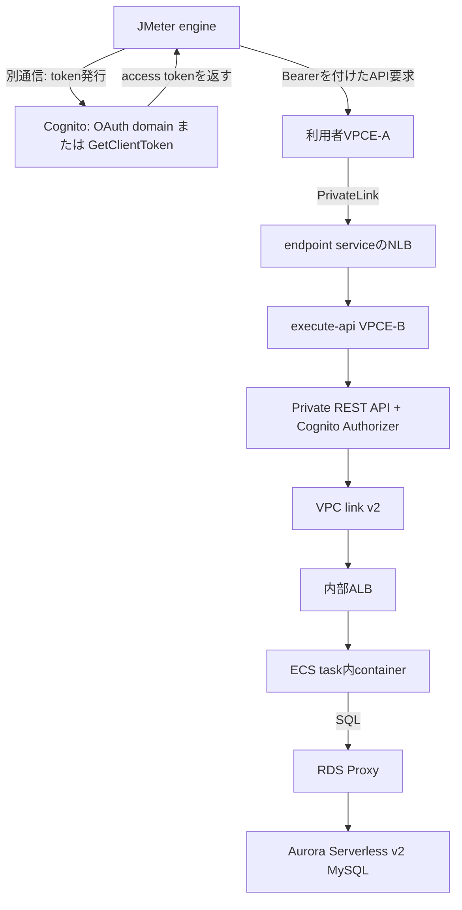

# JMeterによるPrivate REST API負荷試験の方式評価

確認日：2026-10-18（日本時間）

対象は **REST APIのPrivateエンドポイント**。利用者側VPCエンドポイント → エンドポイントサービスのNLB → execute-api用VPCエンドポイント、という前段経路はユーザー確認済みです。

推奨は **本番と同じ入口からの全経路試験を主試験とし、Cognitoトークンは実運用どおり再利用すること**です。内部ALB直接試験は、ECS・RDS Proxy・Auroraの能力を切り分ける補助試験に使います。NLB直接接続でも、その先のAPI Gatewayが要求する認証は必要です。

AWS環境への変更や実負荷試験は実施していません。実URL・ARN・CIDR・TLS終端・SLO・SQLが未提示のため、必要な変更を条件別に示します。性能値の断定や、実行していない疎通の合格判定は行いません。

## 構成図



## 読み進め方

最初に結論と方式比較を読み、採用する入口について「Cognitoと認可」「経路別の設定」「ALBとDB」を確認します。実装担当者は「JMeter設計」「設定例」、試験判定担当者は「監視と判定」「実施と変更管理」を使います。歴史は古い資料との違いを理解するために添えています。

## 00 結論

対象はPrivate REST API。主試験は利用者側VPCエンドポイントから開始し、トークンを実運用どおり再利用する。

### K01 今回の推奨

主試験は「利用者側VPCエンドポイント → エンドポイントサービスのNLB → execute-api用VPCエンドポイント → Private REST API → VPC link v2 → 内部ALB → ECS → RDS Proxy → Aurora MySQL」の経路を通す。API利用者が受ける性能・失敗を確認できる。

補助試験を内部ALB直接接続で実施し、アプリ・DBの処理能力を調べる。NLB直接接続とexecute-api直結は、障害箇所を絞る必要があるときに追加する。

根拠：[S01 Private REST APIs](https://docs.aws.amazon.com/apigateway/latest/developerguide/apigateway-private-apis.html)、[S11 Private integrations for REST APIs](https://docs.aws.amazon.com/apigateway/latest/developerguide/private-integration.html)、[S15 Create a service powered by PrivateLink](https://docs.aws.amazon.com/vpc/latest/privatelink/create-endpoint-service.html)。

### K02 認証と入口は別の選択

「Cognitoから始める」「NLBにつなぐ」「ALBにつなぐ」は完全な三択ではない。Cognitoは通行証を発行する別の通信先。NLB経由でも、その先のAPI Gatewayが認証を求めればCognitoの有効なトークンが必要。

二つの軸を決める。①APIの入口、②トークン取得の方式と頻度。全経路試験でも、APIのたびにトークンを取り直す必要はない。

根拠：[S04 Integrate a REST API with a Cognito user pool](https://docs.aws.amazon.com/apigateway/latest/developerguide/apigateway-enable-cognito-user-pool.html)、[S06 The token endpoint](https://docs.aws.amazon.com/cognito/latest/developerguide/token-endpoint.html)、[S22 Managing token expiration and caching](https://docs.aws.amazon.com/cognito/latest/developerguide/amazon-cognito-user-pools-using-tokens-caching-tokens.html)。

### K03 「全部をシナリオ」の意味

JMeterが実行するのは、トークン発行要求とHTTP API要求。NLB・VPC link・ALB・ECS・RDS Proxy・Auroraには、通常そのAPI要求の結果として自動的に到達する。各装置へ順番にHTTP要求を作るわけではない。

JMeterにDBのJDBC Samplerを足すと別の負荷が加わる。今回のAPI経路試験では追加しない。APIが実際にDBへアクセスした証拠をアプリの計測で確認する。

位置づけ：設計判断。

### K04 パブリック端末は必須ではない

従来の /oauth2/token は公開エンドポイントへの送信経路が必要。ただし実行機にパブリックIPやインターネットからの受信許可は不要。Private subnetの実行機からNATや社内プロキシを使える。

API本体はPrivate経路が必要。インターネットに出られるだけの自宅PCではPrivate APIへ届かない。VPC内実行機、またはVPN／Direct Connect等で接続された端末を使う。

根拠：[S01 Private REST APIs](https://docs.aws.amazon.com/apigateway/latest/developerguide/apigateway-private-apis.html)、[S02 Invoke a private API](https://docs.aws.amazon.com/apigateway/latest/developerguide/apigateway-private-api-test-invoke-url.html)、[S06 The token endpoint](https://docs.aws.amazon.com/cognito/latest/developerguide/token-endpoint.html)、[S08 Access Cognito using an interface endpoint](https://docs.aws.amazon.com/cognito/latest/developerguide/vpc-interface-endpoints.html)。

### K05 完全閉域M2Mの新しい選択

2026-08-31追加のGetClientTokenは、cognito-idpのInterface VPC endpoint経由でM2Mトークンを取得できる。従来 /oauth2/token 自体がPrivateLink対応になったわけではない。

本番がOAuthドメイン方式なら、まず同方式で主試験を実施する。GetClientTokenへの変更は閉域化の設計変更として、クライアント設定・発行claim・運用差を別に検証する。

根拠：[S07 GetClientToken API](https://docs.aws.amazon.com/cognito-user-identity-pools/latest/APIReference/API_GetClientToken.html)、[S08 Access Cognito using an interface endpoint](https://docs.aws.amazon.com/cognito/latest/developerguide/vpc-interface-endpoints.html)、[S09 Cognito M2M without a user pool domain（2026-08-31）](https://aws.amazon.com/about-aws/whats-new/2026/08/amazon-cognito-get-client-token/)。

### K06 試験専用Authorizer

同じユーザープール・同じメソッドscopeを使う試験用app clientを作るだけなら、通常は既存Cognito Authorizerを使える。app clientとAuthorizerは一対一ではない。

専用Authorizerが必要なのは、別ユーザープールや別認可仕様を意図して使う場合。単にJMeterだからという理由で作らない。

根拠：[S04 Integrate a REST API with a Cognito user pool](https://docs.aws.amazon.com/apigateway/latest/developerguide/apigateway-enable-cognito-user-pool.html)、[S05 Scopes, M2M, and resource servers](https://docs.aws.amazon.com/cognito/latest/developerguide/cognito-user-pools-define-resource-servers.html)。

### K07 内部ALBの位置づけ

ALB直接試験はECS・DBの限界を調べやすいが、利用者側PrivateLink、前段NLB、API Gatewayの認可・制限・変換、VPC linkを通らない。これだけでAPI全経路合格とは言えない。

ALBのSGを試験用SGからの必要ポートだけ許可し、Host・パス・本文・認証前提を再現する。バックエンドがJWTを検証する場合はALB直接でもトークンが必要。

根拠：[S13 Set up a private integration](https://docs.aws.amazon.com/apigateway/latest/developerguide/set-up-private-integration.html)、[S27 ALB user authentication](https://docs.aws.amazon.com/elasticloadbalancing/latest/application/listener-authenticate-users.html)。

### K08 変更範囲の基本方針

既に通る経路は設定を増やさず再利用する。試験用app client、負荷生成機、試験データ、監視、必要なSG許可を優先する。専用stageはDBや共有クォータを自動的には分離しない。

変更前後の差分、対象環境、戻し方を一覧化する。試験のためにAuthorizerをNONEにしたり、ALBをinternet-facingに変更したりしない。

位置づけ：設計判断。

### K09 最新情報の重要な修正

REST APIからALBへのVPC link v2直接統合は2025-11-21に対応済み。CognitoのM2M app client数に対する料金は2025-11-03に廃止され、成功したトークン要求に対する料金が継続している。

「RESTでは必ずバックエンドNLBが必要」「試験用clientを作ると固定client料金が増える」という古い前提を採用しない。前段PrivateLink用NLBは別の役割なので残る。

根拠：[S10 REST APIs support private ALB integration（2025-11-21）](https://aws.amazon.com/about-aws/whats-new/2025/11/api-gateway-rest-apis-integration-load-balancer/)、[S19 Cognito M2M app client price removal（2025-11-03）](https://aws.amazon.com/about-aws/whats-new/2025/11/amazon-cognito-removes-machine-machine-app-client-price-dimension/)、[S20 Amazon Cognito pricing](https://aws.amazon.com/cognito/pricing/)。

### K10 この資料での確定範囲

ユーザー確認済み：Private REST API、利用者側VPCE → サービスNLB → execute-api VPCE、後段VPC link v2・ALB・ECS・RDS Proxy・Aurora Serverless v2 MySQL。

実環境のリージョン、TLS終端、URL、クォータ、SLO、アプリ認可・SQLは未提示。以下は条件を網羅した設計資料であり、AWS設定を変更した結果や実測性能ではない。

位置づけ：ユーザー確認／未提示条件。

## 01 構成と用語

「受付で通行証をもらう通信」と「通行証を持って仕事を頼む通信」を分けて読む。

### A01 Cognito

学校の受付で、有効期限つきの入館証をもらう場面に近い。M2Mは人のログインではなく、プログラム自身のclient IDとsecretで入館証を取得する。

①JMeter → Cognito：トークン発行。②JMeter → API：Authorization: Bearer <access token>。APIデータがCognitoを経由してECSへ転送されるわけではない。

根拠：[S05 Scopes, M2M, and resource servers](https://docs.aws.amazon.com/cognito/latest/developerguide/cognito-user-pools-define-resource-servers.html)、[S06 The token endpoint](https://docs.aws.amazon.com/cognito/latest/developerguide/token-endpoint.html)。

### A02 scopeと認可

認証は「だれかの確認」、認可は「何をしてよいかの確認」。scopeは入館証に書く「図書室で読む」「本を登録する」のような許可。

例：orders/read と orders/write。読み取り試験に書き込みscopeは付けない。M2Mでユーザー名・パスワード・MFA・画面操作は通常不要。

根拠：[S05 Scopes, M2M, and resource servers](https://docs.aws.amazon.com/cognito/latest/developerguide/cognito-user-pools-define-resource-servers.html)、[S37 RFC 6749（2012-10）](https://www.rfc-editor.org/info/rfc6749/)。

### A03 利用者側VPCE-A

別の校舎にあるサービスへ通じる専用の入口。JMeterが本番利用者と同じ場所から入るためのInterface VPC endpoint。

ServiceNameは事業者側のvpce-svc-…を指す。execute-api用のVPCE-Bとは別物。利用者側VPCEを通るのが主試験P1。

根拠：[S14 Configure an endpoint service](https://docs.aws.amazon.com/vpc/latest/privatelink/configure-endpoint-service.html)、[S15 Create a service powered by PrivateLink](https://docs.aws.amazon.com/vpc/latest/privatelink/create-endpoint-service.html)。

### A04 サービス設定とNLB

VPCエンドポイントサービスは「誰に専用入口を提供するか」という設定。実際の通信を受ける装置がNLB。サービス名そのものにHTTPを送るわけではない。

NLBはL4の接続振り分け役。APIのJSON本文やCognito scopeを読んで認可する役ではない。NLB直接P2はVPCE-Aを省く。

根拠：[S15 Create a service powered by PrivateLink](https://docs.aws.amazon.com/vpc/latest/privatelink/create-endpoint-service.html)、[S39 NLB launch（2017-09-07）](https://aws.amazon.com/about-aws/whats-new/2017/09/announcing-network-load-balancer-for-elastic-load-balancing/)。

### A05 execute-api用VPCE-B

AWSのAPI Gatewayサービスへ入るための別の専用入口。NLBのターゲットがこのVPCEのENIのプライベートIPである構成を前提にする。

ServiceNameはcom.amazonaws.<region>.execute-api。API Gatewayのaws:SourceVpceに通常現れるのはVPCE-B。VPCE-AのIDを指定すると一致しない。

根拠：[S01 Private REST APIs](https://docs.aws.amazon.com/apigateway/latest/developerguide/apigateway-private-apis.html)、[S03 VPC endpoint policies for private APIs](https://docs.aws.amazon.com/apigateway/latest/developerguide/apigateway-vpc-endpoint-policies.html)。

### A06 API Gateway

学校の門番兼案内所。トークンやscopeを確認し、呼び出し回数を制御し、URL・ヘッダーをバックエンド向けに変換する。

Privateは「利用者からAPIへの入口」が非公開という意味。Private integrationは「APIからバックエンド」が非公開という意味。二つは別の設定。

根拠：[S01 Private REST APIs](https://docs.aws.amazon.com/apigateway/latest/developerguide/apigateway-private-apis.html)、[S04 Integrate a REST API with a Cognito user pool](https://docs.aws.amazon.com/apigateway/latest/developerguide/apigateway-enable-cognito-user-pool.html)、[S11 Private integrations for REST APIs](https://docs.aws.amazon.com/apigateway/latest/developerguide/private-integration.html)。

### A07 VPC link v2

API Gatewayから内部ALBへ渡る専用の通路。利用者側のVPCE-Aやexecute-apiのVPCE-Bと混同しない。

V2は指定subnetにENIを作る。API・VPC link・ALBはこの統合では同一AWSアカウントを前提に確認する。API Gateway自体を自分のsubnetに配置する意味ではない。

根拠：[S11 Private integrations for REST APIs](https://docs.aws.amazon.com/apigateway/latest/developerguide/private-integration.html)、[S12 Set up VPC links V2](https://docs.aws.amazon.com/apigateway/latest/developerguide/apigateway-vpc-links-v2.html)。

### A08 ALBとECS

ALBは「注文内容を見て窓口を選ぶ係」。ECS serviceは「必要な数の作業員を維持する仕組み」、task内containerは「実際に注文を処理する作業員」。

ALBのHost/path ruleからtarget groupへ進む。ECS service自体が独立したHTTP中継機器なのではなく、task/containerがHTTP要求を受ける。

根拠：[S13 Set up a private integration](https://docs.aws.amazon.com/apigateway/latest/developerguide/set-up-private-integration.html)、[S31 ECS Service Auto Scaling](https://docs.aws.amazon.com/AmazonECS/latest/developerguide/service-auto-scaling.html)。

### A09 RDS ProxyとAurora

RDS ProxyはDBへの接続を貸し出す受付。Auroraは本や台帳を保管し、検索・更新をする場所。Serverless v2は必要な計算力を調整する仕組み。

SQLはECSのアプリが発行する。CognitoのBearer tokenがそのままMySQLのログイン情報になるわけではない。DB認証はアプリ／Proxy側の別契約。

根拠：[S32 RDS Proxy connection considerations](https://docs.aws.amazon.com/AmazonRDS/latest/AuroraUserGuide/rds-proxy-connections.html)、[S35 Aurora Serverless administration](https://docs.aws.amazon.com/AmazonRDS/latest/AuroraUserGuide/aurora-serverless-v2-administration.html)。

### A10 往復とキャッシュ

API成功の応答は逆方向に戻る。途中のAPIキャッシュやアプリキャッシュが応答すると、DBまで届かない要求もある。

「全経路の配線がある」と「全要求がAuroraでSQLを実行した」は別。キャッシュ命中率とDBアクセス件数を一緒に記録する。

根拠：[S28 API Gateway metrics](https://docs.aws.amazon.com/apigateway/latest/developerguide/api-gateway-metrics-and-dimensions.html)。

### A11 SG・NACL・DNS・TLS

SGは入口の許可表、NACLはsubnet境界の許可表、DNSは名前から住所を引く電話帳、TLSは暗号化と相手確認。どれか一つ通ればよいわけではない。

SGは状態を追跡する。NACLは戻り通信の一時ポートも必要。DNS成功、TCP成功、TLS成功、HTTP認可成功、業務成功を順番に分けて確認する。

根拠：[S16 NLB security groups](https://docs.aws.amazon.com/elasticloadbalancing/latest/network/load-balancer-security-groups.html)、[S18 Security policies for REST APIs](https://docs.aws.amazon.com/apigateway/latest/developerguide/apigateway-security-policies.html)、[S49 Create a private API](https://docs.aws.amazon.com/apigateway/latest/developerguide/apigateway-private-api-create.html)。

### A12 負荷と計測の言葉

RPSは1秒に送る要求数。同時数は同時に待っている要求や動作中の仮想クライアント数。p95は100件のうち遅い側の5件を除いた境目。

平均だけでは一部の極端な遅さを隠す。RPS・成功率・p95/p99・エラー件数・実際のDB処理量をセットで評価する。

位置づけ：分析方法。

## 02 方式比較

到達範囲で評価する。未計測の速度差や恣意的な点数で順位を決めない。

### C01 方式の定義

P1：VPCE-A→サービスNLB→VPCE-B→API Gateway→VPC link→ALB→ECS→Proxy→DB。P2：NLBから開始し、それ以降はP1と同じ。

P3：VPCE-Bから開始し、API Gateway以降を通す。P4：ALBから開始し、ECS→Proxy→DBを通す。全方式でDB到達は実際のAPI実装・キャッシュ次第。

位置づけ：確認済み構成＋設計判断。

### C02 本番経路の再現

P1：今回の利用者経路を最もよく再現。P2：前段PrivateLink、接続承認、VPCE-AのDNS・SG・AZ選択を評価できない。

P3：前段NLBも省略。P4：入口のネットワークに加え、API Gateway認可・制限・変換・VPC linkを省略。

位置づけ：設計判断。

### C03 認証の必要性

P1/P2：Cognito Authorizerを通るため有効なaccess tokenとscopeが必要。NLBを選んでも認証は省略できない。

P3：P1と同じ。P4：アプリが独自にJWTを検証するなら必要。ALB／アプリに認証がなければAPI Gatewayの認可は評価しない。

根拠：[S04 Integrate a REST API with a Cognito user pool](https://docs.aws.amazon.com/apigateway/latest/developerguide/apigateway-enable-cognito-user-pool.html)、[S27 ALB user authentication](https://docs.aws.amazon.com/elasticloadbalancing/latest/application/listener-authenticate-users.html)。

### C04 正常時の使いやすさ

P1：既存の利用者接続とDNSを使えれば、HTTP Sampler自体は普通のHTTPS要求。P2：NLBのTLS・Host・許可送信元を合わせる作業が増える場合がある。

P3：VPC内でVPCE-Bへ直接接続できれば設定は比較的単純。P4：ALBの許可とbackend URL契約が分かれば単純。ただし認証claimをアプリが前提にすると難しくなる。

根拠：[S02 Invoke a private API](https://docs.aws.amazon.com/apigateway/latest/developerguide/apigateway-private-api-test-invoke-url.html)、[S13 Set up a private integration](https://docs.aws.amazon.com/apigateway/latest/developerguide/set-up-private-integration.html)。

### C05 追加のネットワーク設定

P1：利用者側試験用SG、必要なら新VPCE-Aとサービス接続承認。P2：NLBに対する直接接続経路とSG許可。

P3：VPCE-BのSG許可。新VPCE-Bを使うならAPI resource policyも確認。P4：ALBへの経路・SG許可。Proxy/DBへJMeter用の接続口を開ける必要はない。

根拠：[S14 Configure an endpoint service](https://docs.aws.amazon.com/vpc/latest/privatelink/configure-endpoint-service.html)、[S16 NLB security groups](https://docs.aws.amazon.com/elasticloadbalancing/latest/network/load-balancer-security-groups.html)、[S49 Create a private API](https://docs.aws.amazon.com/apigateway/latest/developerguide/apigateway-private-api-create.html)。

### C06 ボトルネック切り分け

P1：総合品質が分かるが原因はログとの相関が必要。P2：P1で失敗しP2で成功なら、VPCE-A周辺を重点確認。

P3：P2と差があるならNLB・そのTLS／targetを確認。P4：P3と差があるならAPI Gateway・VPC link・変換・throttleを確認。単独比較だけで原因確定はしない。

位置づけ：分析方法。

### C07 費用の傾向

P1：二つのVPCE、NLB、API Gateway等の通過コストが含まれる。P2：試験要求はVPCE-Aを通らないが、既存VPCE-Aの時間料金は残り得る。

P3：前段NLBのデータ処理を省く。P4：API Gateway等の要求処理を省く。常設リソースの時間料金と試験による増分を分ける。正確な金額はリージョン・時間・転送量で計算する。

根拠：[S20 Amazon Cognito pricing](https://aws.amazon.com/cognito/pricing/)。

### C08 再現できない障害

P1：試験機を本番利用者と別AZ・別ネットワークに置けば、その部分は再現できない。P2：サービスへの接続承認不備やVPCE-A障害は見つからない。

P3：さらにNLBのresetやtarget更新漏れが見つからない。P4：さらにscope不足、API Gatewayの429、integration timeout、VPC link障害が見つからない。

位置づけ：設計判断。

### C09 運用上の主な利点

P1：受入試験の説明が明確で、システム全体のSLOを判定できる。P2：利用者接続が未完成でも、NLB以降を先に確認できる。

P3：API Gatewayから後ろを独立検証できる。P4：API Gatewayの上限に邪魔されず、アプリ／DBの飽和点を探索しやすい。

位置づけ：設計判断。

### C10 運用上の主な欠点

P1：準備対象が多く、監視も複数サービスにまたがる。P2：新しい直接許可が必要だと、本来の接続境界に例外を増やす。

P3：利用者経路とは異なる数字になる。P4：認可前提・パス変換・キャッシュ差により、同じAPI名でも別の仕事を測る危険がある。

位置づけ：設計判断。

### C11 入口の選定基準

「利用者がピーク時に使えるか」が目的ならP1。「PrivateLink区間だけを除いて原因を探る」ならP2。

「API Gateway以降の結合を確認」ならP3。「ECS・SQL・Proxyの処理能力を調べる」ならP4。主試験と補助試験で役割を分担する。

位置づけ：推奨。

### C12 同じ条件の比較

P1/P2間でAPI、payload、データ分布、到着RPS、試験時間、実行機能力、AZ、keep-alive、トークン再利用を揃える。

P3/P4では加えてbackendのHost・パス・claim注入・cache hit率を照合。各p95を引き算して「装置一台のp95」とはしない。

位置づけ：測定方法。

### C13 トークン取得パターンT1

T1：試験前に取得して有効期限内だけAPIを実行。P1/P2/P3に利用可能。API本体の定常性能に集中でき、実行機にCognito到達経路を持たせずに済む場合がある。

期限と配布の安全性、受け渡し時間を考慮。長時間試験、初回発行、更新障害は評価できない。失効直前のtokenを使わず、終了までの余裕を確認する。

根拠：[S06 The token endpoint](https://docs.aws.amazon.com/cognito/latest/developerguide/token-endpoint.html)、[S22 Managing token expiration and caching](https://docs.aws.amazon.com/cognito/latest/developerguide/amazon-cognito-user-pools-using-tokens-caching-tokens.html)。

### C14 トークン取得パターンT2

T2：開始時・期限前に取得し、通常のAPI呼出しでは再利用。今回の推奨。各キャッシュ単位・scope・clientの実運用をモデル化する。

P1＋T2を受入試験に使う。定常APIの統計とAUTH統計を分け、更新発生時の業務待ち時間も別ラベルで残す。

根拠：[S22 Managing token expiration and caching](https://docs.aws.amazon.com/cognito/latest/developerguide/amazon-cognito-user-pools-using-tokens-caching-tokens.html)。

### C15 トークン取得パターンT3

T3：APIのたびに発行。実運用が毎回発行する場合、または認証発行能力の独立試験に限って有効。API RPSと同じ量のCognito要求が発生する。

実運用が再利用するのにT3を主試験にすると、Cognito上限や費用を測ってしまう。発行失敗でAPIが送られず、ECS・DBが軽いまま「試験不能」になる。

根拠：[S21 Cognito quotas](https://docs.aws.amazon.com/cognito/latest/developerguide/quotas.html)、[S22 Managing token expiration and caching](https://docs.aws.amazon.com/cognito/latest/developerguide/amazon-cognito-user-pools-using-tokens-caching-tokens.html)。

### C16 費用の見積り項目

Cognito成功発行、VPCE-A/Bの時間・処理量、NLB時間・NLCU、API Gateway要求、CognitoへのNAT/proxy等を確認する。GetClientToken方式ではcognito-idp VPCEの費用も追加候補。

全方式でALB・ECS・RDS Proxy・Aurora ACU/I/O・ログ/メトリクス・データ転送を考慮。P4で前段を通さなくても常設時間料金は自動的に消えない。リージョン・既存使用量に合わせた増分見積りを作る。

根拠：[S20 Amazon Cognito pricing](https://aws.amazon.com/cognito/pricing/)。

## 03 Cognitoと認可

試験用app clientを最小権限で準備する。従来OAuthと新APIの設定を混ぜない。

### I01 ユーザープール

【通常変更なし】本番と同等の認可を測るなら、対象環境で既存Authorizerが参照するpoolを使う。identity poolはAWS一時認証情報の別機能で、今回のM2Mに通常追加しない。

poolのリージョン・issuer、AuthorizerのproviderARNs、既存resource server、試験環境の分離方針を確認する。pool新設は必須ではない。

根拠：[S04 Integrate a REST API with a Cognito user pool](https://docs.aws.amazon.com/apigateway/latest/developerguide/apigateway-enable-cognito-user-pool.html)、[S05 Scopes, M2M, and resource servers](https://docs.aws.amazon.com/cognito/latest/developerguide/cognito-user-pools-define-resource-servers.html)。

### I02 試験用app client

【追加推奨】同じpoolに用途・所有者・期限が分かるconfidential clientを用意し、client secretを生成する。本番clientのsecret共有を避け、試験終了後に整理しやすくする。

client IDは負荷のユーザー数ではない。1個のclientを複数の実行機が使うことは可能。分離してもpool／アカウントの共有クォータやbackend容量は分離されない。

根拠：[S05 Scopes, M2M, and resource servers](https://docs.aws.amazon.com/cognito/latest/developerguide/cognito-user-pools-define-resource-servers.html)、[S07 GetClientToken API](https://docs.aws.amazon.com/cognito-user-identity-pools/latest/APIReference/API_GetClientToken.html)、[S21 Cognito quotas](https://docs.aws.amazon.com/cognito/latest/developerguide/quotas.html)。

### I03 OAuthドメイン方式の設定

【T2で従来方式を使う場合】ユーザープールドメインを使い、AllowedOAuthFlowsUserPoolClient=true、AllowedOAuthFlows=[client_credentials]、AllowedOAuthScopesに必要なcustom scopeを指定する。

client secretを持たせる。M2M専用clientでユーザー対話型のcode/implicitフローを混ぜない。resource serverのidentifier/scopeを完全一致で確認し、callback URLやテストユーザーはM2Mに通常不要。

根拠：[S05 Scopes, M2M, and resource servers](https://docs.aws.amazon.com/cognito/latest/developerguide/cognito-user-pools-define-resource-servers.html)、[S06 The token endpoint](https://docs.aws.amazon.com/cognito/latest/developerguide/token-endpoint.html)。

### I04 OAuthの送信内容

HTTPS POST /oauth2/token。Content-Typeはapplication/x-www-form-urlencoded。grant_type=client_credentials、scopeは空白区切り。client_secret_basicまたはclient_secret_postでclientを認証する。

推奨例はBasicヘッダー方式。JMeterでformパラメーターをURLエンコードし、Basicの値はメモリーで作る。BearerヘッダーをこのSamplerへ継承させない。

根拠：[S06 The token endpoint](https://docs.aws.amazon.com/cognito/latest/developerguide/token-endpoint.html)、[S37 RFC 6749（2012-10）](https://www.rfc-editor.org/info/rfc6749/)。

### I05 OAuthの受信内容

$.access_token、$.expires_in、$.token_typeを読む。client_credentialsはaccess tokenを得るフローであり、ID token／refresh tokenを前提にしない。

期限前の更新は、同じclient credentialsで新しいtokenを発行する操作。grant_type=refresh_tokenを使う設計にしない。200だけでなく必須項目と正の寿命も検証する。

根拠：[S06 The token endpoint](https://docs.aws.amazon.com/cognito/latest/developerguide/token-endpoint.html)。

### I06 GetClientTokenの設定

【閉域方式を選ぶ場合】secret付きapp clientにExplicitAuthFlows=[ALLOW_CLIENT_TOKEN_AUTH]を設定し、必要なresource server custom scopeを関連付ける。ユーザー認証フローとの併用は不可。

新しい試験clientで検証する。ユーザープールドメインは不要だが、既存本番ドメインを削除する必要はない。既存clientのフローを無計画に置き換えない。

根拠：[S05 Scopes, M2M, and resource servers](https://docs.aws.amazon.com/cognito/latest/developerguide/cognito-user-pools-define-resource-servers.html)、[S07 GetClientToken API](https://docs.aws.amazon.com/cognito-user-identity-pools/latest/APIReference/API_GetClientToken.html)。

### I07 GetClientTokenの送信

cognito-idpのリージョナルAPIへJSONでClientId、Secret、Scopesを送る。client secretで認証するため、IAMロールの権限だけでは代用できない。

HTTP例は設定例G02。Content-Type: application/x-amz-json-1.1、X-Amz-Target: AWSCognitoIdentityProviderService.GetClientToken。UserPoolIdやSecretHashではなく、指定されたClientId／Secretを使う。

根拠：[S07 GetClientToken API](https://docs.aws.amazon.com/cognito-user-identity-pools/latest/APIReference/API_GetClientToken.html)。

### I08 GetClientTokenの受信

$.ClientAuthenticationResult.AccessToken、同.ExpiresIn、同.TokenTypeを読む。OAuthドメイン方式とJSON階層が異なる。

失敗時はHTTP 400でもTooManyRequestsException等が含まれる。429だけを探して発行制限を見逃さない。エラー名を分類し、secretや応答tokenをログへ出さない。

根拠：[S07 GetClientToken API](https://docs.aws.amazon.com/cognito-user-identity-pools/latest/APIReference/API_GetClientToken.html)。

### I09 Cognito用VPCE

【閉域方式のみ追加候補】com.amazonaws.<region>.cognito-idpのInterface endpointを実行機側VPCに準備。Private DNSを有効化し、VPCのDNS設定・endpoint SGの443を確認する。

endpoint policy・組織のRCPでGetClientTokenが許可されることを確認する。IAM identity policyによる認証とは区別。cognito-identity endpointやexecute-api endpointは代用にならない。

根拠：[S08 Access Cognito using an interface endpoint](https://docs.aws.amazon.com/cognito/latest/developerguide/vpc-interface-endpoints.html)。

### I10 OAuth送信経路

【OAuth方式のみ】private subnetからNAT Gateway、承認済みHTTPS proxy、企業の出口等でCognito domainに送信できるようにする。インバウンドの公開は不要。

proxyを使う場合は公開Cognitoのみ経由させ、Private APIの宛先は除外する。出口のDNS、TCP 443、proxy認証・証明書、NATの接続数も確認する。

根拠：[S06 The token endpoint](https://docs.aws.amazon.com/cognito/latest/developerguide/token-endpoint.html)、[S08 Access Cognito using an interface endpoint](https://docs.aws.amazon.com/cognito/latest/developerguide/vpc-interface-endpoints.html)。

### I11 既存Authorizerの再利用

【通常変更なし】providerARNsが同じpoolを指し、Authorizationをtoken sourceとするCOGNITO_USER_POOLS Authorizerを使う。clientごとのAuthorizer新設は標準要件ではない。

別poolを試験用に使うなら、pool追加または別Authorizerを対象APIに設定する必要がある。その試験では本来のissuer・鍵・pool依存が変わることを記録する。

根拠：[S04 Integrate a REST API with a Cognito user pool](https://docs.aws.amazon.com/apigateway/latest/developerguide/apigateway-enable-cognito-user-pool.html)。

### I12 メソッドのscope

【必須確認】access tokenでAPIを保護する各メソッドにAuthorization Scopesを設定する。空欄はID tokenとして扱う側の設定となり、M2Mの検証と噛み合わない。

複数scopeを並べた場合は「どれか一致」のOR条件。readとwriteを両方必須にするAND条件ではない。不要な試験専用scopeを本番メソッドへ追加しない。

根拠：[S04 Integrate a REST API with a Cognito user pool](https://docs.aws.amazon.com/apigateway/latest/developerguide/apigateway-enable-cognito-user-pool.html)、[S05 Scopes, M2M, and resource servers](https://docs.aws.amazon.com/cognito/latest/developerguide/cognito-user-pools-define-resource-servers.html)。

### I13 client IDの扱い

同じpoolのclientを区別する必要がある業務では、scopeだけで十分か検討する。RESTのCognito Authorizerに、HTTP APIのJWT Authorizerと同じAudience欄があると思い込まない。

access tokenのclient_idを制限する契約があるなら、既存のアプリ検証または認可設計に合わせる。専用Authorizerという名前だけではclientが隔離されない。

根拠：[S04 Integrate a REST API with a Cognito user pool](https://docs.aws.amazon.com/apigateway/latest/developerguide/apigateway-enable-cognito-user-pool.html)、[S50 Understanding the access token](https://docs.aws.amazon.com/cognito/latest/developerguide/amazon-cognito-user-pools-using-the-access-token.html)。

### I14 aud正規表現とテスト画面

REST Cognito AuthorizerのToken validationはID tokenのaudを対象とする。通常のM2M tokenに合わないaud条件を足すと拒否の原因になる。

AuthorizerコンソールのTestはaccess token検証に使えない。デプロイ済みAPIへ実際にHTTPS要求を送り、scopeが足りる／足りないケースを確認する。

根拠：[S04 Integrate a REST API with a Cognito user pool](https://docs.aws.amazon.com/apigateway/latest/developerguide/apigateway-enable-cognito-user-pool.html)。

### I15 変更の反映

Authorizer、メソッドscope、統合等を変更した場合は対象REST APIを再デプロイする。コンソール上の編集状態と、試験が呼ぶstageのdeploymentが同じか確認する。

同一メソッドの認可を「試験stageだけ別物」とするには、deploymentやstage変数を含む設計が必要。stage名を増やしただけで安全に独立すると考えない。

根拠：[S04 Integrate a REST API with a Cognito user pool](https://docs.aws.amazon.com/apigateway/latest/developerguide/apigateway-enable-cognito-user-pool.html)、[S13 Set up a private integration](https://docs.aws.amazon.com/apigateway/latest/developerguide/set-up-private-integration.html)。

### I16 secretとtokenの保存

JMX、Git、Excel、コマンドラインの-Jsecret、JTLのresponse bodyへ実値を保存しない。承認済みsecret配布から実行機の環境変数やアクセス制御された一時領域へ渡す。

環境変数もホスト内では秘密管理が必要。各workerへ配布し、Debug Sampler・全ヘッダーログを無効化。secretのローテーションと既発行JWTの有効期限を別に考える。

根拠：[S07 GetClientToken API](https://docs.aws.amazon.com/cognito-user-identity-pools/latest/APIReference/API_GetClientToken.html)、[S23 JMeter Best Practices](https://jmeter.apache.org/usermanual/best-practices.html)。

### I17 発行制限

確認日の公式表ではClientAuthenticationにclient_credentialsとGetClientTokenが並び、既定150 RPS、Adjustable=Noと記載。domainには送信元IP・client・domain全体の別制限もある。

新APIへ切り替えても発行上限を迂回できるとは考えない。実環境のリージョン・共有利用・契約を実施前に確認。大量のclient新設で制限を逃れる設計にしない。

根拠：[S21 Cognito quotas](https://docs.aws.amazon.com/cognito/latest/developerguide/quotas.html)。

### I18 発行頻度と料金

tokenは期限内で再利用できる。要求ごとの発行より、実運用のキャッシュ単位ごとの再発行に合わせる方が本来の利用量を再現できる。

現在のM2M課金は成功したtoken応答が基本。client数の固定料金は廃止済み。S05の開発者ガイドには旧課金説明が残るため、料金判断は現行料金表S20と改定S19を優先する。

根拠：[S19 Cognito M2M app client price removal（2025-11-03）](https://aws.amazon.com/about-aws/whats-new/2025/11/amazon-cognito-removes-machine-machine-app-client-price-dimension/)、[S20 Amazon Cognito pricing](https://aws.amazon.com/cognito/pricing/)、[S22 Managing token expiration and caching](https://docs.aws.amazon.com/cognito/latest/developerguide/amazon-cognito-user-pools-using-tokens-caching-tokens.html)。

### I19 発行とJWT検証の分離

tokenを発行する通信と、発行済みtokenの署名・期限・scopeを検証する処理は別。APIのたびにJMeterがCognitoへ発行要求を送る必要はない。

access tokenを再利用しても、P1/P2/P3の各API要求はAuthorizerの保護を受ける。これは「認証を省いた試験」ではない。JWT検証に必要な鍵等の管理と、token発行RPSを混同しない。

根拠：[S04 Integrate a REST API with a Cognito user pool](https://docs.aws.amazon.com/apigateway/latest/developerguide/apigateway-enable-cognito-user-pool.html)、[S50 Understanding the access token](https://docs.aws.amazon.com/cognito/latest/developerguide/amazon-cognito-user-pools-using-the-access-token.html)。

## 04 経路別の設定

変更必須・条件付き・通常変更なしを区別。SG名は論理名であり実在IDではない。

### N01 実行機の配置

【全方式】JMeter engineを対象入口へ到達できるVPCに置く。P1は利用者VPC、P4はALBと同一VPCまたは接続済みネットワークが分かりやすい。

管理用PCはSSM等で実行を制御できる。管理PCがAWS APIを呼ぶ通信と、JMeter engineが試験対象を呼ぶ通信を区別する。実行機の追加はまだ実施していない。

位置づけ：設計判断。

### N02 利用者VPCE-Aの再利用

【P1】既存VPCE-Aに試験機が到達できれば、試験のために新endpointを作る必要はない。endpoint SGでJMeter-SGからサービスlistenerのTCPポートを許可する。

通常のHTTPSは443。JMeter-SGのoutboundも同ポートを許可。subnet NACL、DNS private name、選択AZ、endpoint状態Availableを確認する。

根拠：[S14 Configure an endpoint service](https://docs.aws.amazon.com/vpc/latest/privatelink/configure-endpoint-service.html)、[S15 Create a service powered by PrivateLink](https://docs.aws.amazon.com/vpc/latest/privatelink/create-endpoint-service.html)。

### N03 新しい利用者VPCE-A

【P1・必要な場合のみ】分離した負荷生成VPCにInterface endpointを作り、サービス名vpce-svc-…、subnet、SGを指定する。

サービス側Allowed principalsに必要なAWS principalを追加し、Acceptance requiredなら接続を承認する。許可だけでは承認完了にならない。全principal許可・自動承認を安易に組み合わせない。

根拠：[S14 Configure an endpoint service](https://docs.aws.amazon.com/vpc/latest/privatelink/configure-endpoint-service.html)、[S15 Create a service powered by PrivateLink](https://docs.aws.amazon.com/vpc/latest/privatelink/create-endpoint-service.html)。

### N04 サービス公開範囲

【P1】Allowed principalsは接続を作る権限、endpoint接続承認は接続単位の許可。API操作権限は後段のCognitoで別に決まる。

試験終了時は新設接続を整理し、追加したprincipal権限も元へ戻す。principal削除だけで既存の接続が切れると決めつけず、接続状態まで確認する。

根拠：[S14 Configure an endpoint service](https://docs.aws.amazon.com/vpc/latest/privatelink/configure-endpoint-service.html)。

### N05 NLBのlistener

【P1/P2】既存listenerのポート・TCP/TLS、target groupのTCP/TLS、TLS終端位置を確認する。JMeterに合わせる目的だけでlistenerを作り替えない。

TCP 443透過ならクライアントTLSがAPI Gatewayまで届く。TLS終端ならNLB証明書と後段TLSが別接続になる。VPCE-Bの443へ平文を送らない。

根拠：[S15 Create a service powered by PrivateLink](https://docs.aws.amazon.com/vpc/latest/privatelink/create-endpoint-service.html)、[S18 Security policies for REST APIs](https://docs.aws.amazon.com/apigateway/latest/developerguide/apigateway-security-policies.html)。

### N06 NLBのPrivateLink SG評価

【P1】Enforce inbound rules on PrivateLink trafficの現状を確認する。有効なら評価される送信元は利用者IPであり、VPCE-AのENI IPとは限らない。

既存設計に合わせて試験機CIDR等を必要最小限で許可。疎通のために一律offにしない。SGなしで作成した既存NLBには後からSGを追加できないため、別制御を確認する。

根拠：[S16 NLB security groups](https://docs.aws.amazon.com/elasticloadbalancing/latest/network/load-balancer-security-groups.html)。

### N07 NLB直接接続の許可

【P2】provider側NLBに到達するルートとNLBの直接流入許可を準備する。PrivateLink経由の許可が、そのまま直接接続にも使えるとは限らない。

P1でNLBのPrivateLink SG評価をoffにしていても、P2の通常流入にはSG規則が働く。試験SGまたは到達後の送信元CIDRを限定する。

根拠：[S16 NLB security groups](https://docs.aws.amazon.com/elasticloadbalancing/latest/network/load-balancer-security-groups.html)。

### N08 NLB target group

【P1/P2】target type=ipの場合、VPCE-Bの各ENI private IPとポートが登録され、意図するAZでhealthyか確認。VPCE再作成時のIP更新手順も確認する。

DNS名を登録したつもりでもIP型targetは自動追随しない。既存更新自動化・監視を確認する。health checkがTCP成功だけなら、scope認可やDB処理の成功は保証しない。

根拠：[S17 Register targets for NLB](https://docs.aws.amazon.com/elasticloadbalancing/latest/network/target-group-register-targets.html)。

### N09 VPCE-BのSG

【P1/P2】NLBからのtarget通信とhealth checkを受け入れる。NLB SG・PrivateLink inbound評価・client IP preserveの組合せで必要な送信元が変わる。

SG参照を使える構成はNLB-SGを使う。PrivateLink評価をoffにした場合等は公式のtarget SG要件に従いNLB private IPも確認。Flow Logsで実際の送信元を確かめる。

根拠：[S16 NLB security groups](https://docs.aws.amazon.com/elasticloadbalancing/latest/network/load-balancer-security-groups.html)、[S17 Register targets for NLB](https://docs.aws.amazon.com/elasticloadbalancing/latest/network/target-group-register-targets.html)。

### N10 VPCE-B直接接続

【P3】同じVPCE-Bを直接使うなら、そのSGにJMeter-SGから443を追加する条件を検討する。後段resource policyのSourceVpceは同じIDのまま。

独立した新VPCE-Bを作るなら、endpoint policy、Private DNS、API resource policy、custom domain associationをすべて照合する。単にSGを開けただけでは通らない。

根拠：[S02 Invoke a private API](https://docs.aws.amazon.com/apigateway/latest/developerguide/apigateway-private-api-test-invoke-url.html)、[S03 VPC endpoint policies for private APIs](https://docs.aws.amazon.com/apigateway/latest/developerguide/apigateway-vpc-endpoint-policies.html)、[S49 Create a private API](https://docs.aws.amazon.com/apigateway/latest/developerguide/apigateway-private-api-create.html)。

### N11 endpoint policyのBearer

【P1/P2/P3】execute-api endpoint policyはCognito BearerをIAM principalとして認証しない。Bearerはanonymousとして評価される。

Resourceを対象API/stage/method/pathに絞り、Principal="*"で通過を許す設計例を使う。最終的な認可はCognito Authorizerで実施。EC2 IAM roleだけをPrincipal指定すると通らない場合がある。

根拠：[S03 VPC endpoint policies for private APIs](https://docs.aws.amazon.com/apigateway/latest/developerguide/apigateway-vpc-endpoint-policies.html)。

### N12 API resource policy

【P1/P2/P3】Private APIはresource policyで到達元VPCEを制限する。今回の連鎖ではSourceVpceはexecute-api側VPCE-B。

VPCE-AのIDを入れない。既存VPCE-B経由のP1/P2は通常変更不要。新VPCE-Bを使う場合だけ必要な許可と既存Deny条件を整合させ、対象stageに反映する。

根拠：[S01 Private REST APIs](https://docs.aws.amazon.com/apigateway/latest/developerguide/apigateway-private-apis.html)、[S03 VPC endpoint policies for private APIs](https://docs.aws.amazon.com/apigateway/latest/developerguide/apigateway-vpc-endpoint-policies.html)、[S49 Create a private API](https://docs.aws.amazon.com/apigateway/latest/developerguide/apigateway-private-api-create.html)。

### N13 二つのVPCEの可視性

VPCE-Bを複数の利用者が共有すると、API GatewayのSourceVpceだけでは元のVPCE-Aを一意に識別できない。NLBを通ることで元IPも変わり得る。

利用者識別はclient_id・scope・業務tenantとサービス接続制御を組み合わせる。元の利用者IPがCognitoやAPI Gatewayまで保たれる前提を置かない。

根拠：[S16 NLB security groups](https://docs.aws.amazon.com/elasticloadbalancing/latest/network/load-balancer-security-groups.html)、[S17 Register targets for NLB](https://docs.aws.amazon.com/elasticloadbalancing/latest/network/target-group-register-targets.html)。

### N14 正しいDNS名を使う

【全HTTP方式】HTTP RequestのServer Nameには証明書・API routingと整合する業務名を使う。接続先だけNLBにしたい場合はDNS設計を合わせる。

NLBの*.elb.amazonaws.com名をURLにしてHostだけAPI IDへ変える方法は、TLS/SNIが一致しないことがある。DNS Cache Managerの静的Host mappingは切り分け用に限定し、記録する。

根拠：[S18 Security policies for REST APIs](https://docs.aws.amazon.com/apigateway/latest/developerguide/apigateway-security-policies.html)、[S24 JMeter Component Reference](https://jmeter.apache.org/usermanual/component_reference.html)。

### N15 P1のTLS透過パターン

NLBがTCP 443透過なら、API IDのexecute-api名、または既存のprivate custom domainをURLに使い、その名前を利用者VPCE-Aへ解決させる構成を確認する。

SNIとHostを同じ正当な名前に保つ。既存Private DNSが別のexecute-api VPCEへ向いてP1を迂回していないか、解決先IPとFlow Logsで確かめる。

根拠：[S02 Invoke a private API](https://docs.aws.amazon.com/apigateway/latest/developerguide/apigateway-private-api-test-invoke-url.html)、[S18 Security policies for REST APIs](https://docs.aws.amazon.com/apigateway/latest/developerguide/apigateway-security-policies.html)。

### N16 P1のNLB TLS終端

NLBにACM証明書がある場合、JMeterが使う名前がその証明書に含まれる必要がある。NLB→VPCE-Bは別のTLS経路とAPI識別の確認が要る。

NLBは通常HTTPのHostを書き換える装置ではない。既存のHost／x-apigw-api-id、backend TLS、API GatewayのSTRICT/BASICの組合せを疎通試験で検証する。

根拠：[S18 Security policies for REST APIs](https://docs.aws.amazon.com/apigateway/latest/developerguide/apigateway-security-policies.html)。

### N17 P3のURL例

Private DNS有効なら https://<api-id>.execute-api.<region>.amazonaws.com/<stage>/<resource>。endpoint固有DNSならHostまたはx-apigw-api-idでAPIを識別する方式もある。

新しいSecurityPolicy_…とSTRICTではHost/SNI整合が必要。endpoint固有DNS＋別Hostという旧来の例を無条件に採用せず、private DNS／private custom domainを優先する。

根拠：[S02 Invoke a private API](https://docs.aws.amazon.com/apigateway/latest/developerguide/apigateway-private-api-test-invoke-url.html)、[S18 Security policies for REST APIs](https://docs.aws.amazon.com/apigateway/latest/developerguide/apigateway-security-policies.html)。

### N18 Private custom domain

【既存利用時】domain側resource policy、API側resource policy、VPCE-Bとのdomain name access association、base path mapping、ACM証明書、利用者側DNSを確認。

名前を作るだけではアクセスできない。別アカウントなら共有・関連付けも確認する。試験を通すためだけに新domainを作る必要はなく、既存経路を使う。

根拠：[S45 Custom domain names for private APIs](https://docs.aws.amazon.com/apigateway/latest/developerguide/apigateway-private-custom-domains.html)。

### N19 Private DNSの副作用

execute-apiのPrivate DNSを有効にすると、同VPCからpublic APIの既定execute-api endpointへアクセスする設計に影響する。

Cognito domainへの出口問題とは別。既存public API呼出しがあるなら個別private hosted zone等の既存DNS方針を確認する。試験で広域DNSを安易に上書きしない。

根拠：[S01 Private REST APIs](https://docs.aws.amazon.com/apigateway/latest/developerguide/apigateway-private-apis.html)、[S02 Invoke a private API](https://docs.aws.amazon.com/apigateway/latest/developerguide/apigateway-private-api-test-invoke-url.html)。

### N20 API keyとusage plan

【既存要件がある場合】Cognito tokenとは別にx-api-keyが必要。試験用keyとusage planの対象stage・throttle・quotaを確認する。

API keyはCognito認証の代用品ではない。keyだけを変えてもアカウント全体のAPI Gateway制限やECS・DB容量は分離されない。

根拠：[S46 API Gateway endpoints and quotas](https://docs.aws.amazon.com/general/latest/gr/apigateway.html)。

### N21 WAF・throttle・cache

【既存有効時】API Gateway/WAFのrate rule、stage/method制限、response cacheを本番同等に保ち、429やcache hitを測る。

バックエンド限界試験で制限を外す場合は独立した実験条件として扱う。通常受入試験の合格値と混ぜない。JMeter用に全セキュリティ規則を除外しない。

根拠：[S28 API Gateway metrics](https://docs.aws.amazon.com/apigateway/latest/developerguide/api-gateway-metrics-and-dimensions.html)、[S46 API Gateway endpoints and quotas](https://docs.aws.amazon.com/general/latest/gr/apigateway.html)。

### N22 VPC link v2

【P1/P2/P3は通常変更なし】既存linkがAVAILABLEで、subnet空きIPとALB到達経路が確保されていることを確認。

V2のsubnet・SGの関連付けは作成後変更不可。関連付け済みSG自体のルールは管理可能。60日未使用でINACTIVEなら復帰が必要なため、定常試験前に状態を確認。

根拠：[S12 Set up VPC links V2](https://docs.aws.amazon.com/apigateway/latest/developerguide/apigateway-vpc-links-v2.html)。

### N23 RESTとHTTP APIの混同防止

【統合確認】REST APIのV2統合はALBのload balancer ARNをintegration targetにし、uriでHost・HTTPSの名前・ポート等を決める。

HTTP APIのlistener ARN指定例をそのまま転用しない。CLIのapigatewayv2でVPC linkを扱うことは、API本体がHTTP APIである証拠ではない。

根拠：[S12 Set up VPC links V2](https://docs.aws.amazon.com/apigateway/latest/developerguide/apigateway-vpc-links-v2.html)、[S13 Set up a private integration](https://docs.aws.amazon.com/apigateway/latest/developerguide/set-up-private-integration.html)。

### N24 VPC linkからALBの許可

【P1/P2/P3は通常変更なし】VpcLink-SGのoutboundをALBのlistenerポートへ、ALB-SGのinboundをVpcLink-SGから許可する。

P4用許可を追加する場合も既存のVpcLink-SG許可を消さない。ALB→task、task→Proxy、Proxy→DBの既存SGは試験機追加のためには通常変更不要。

根拠：[S12 Set up VPC links V2](https://docs.aws.amazon.com/apigateway/latest/developerguide/apigateway-vpc-links-v2.html)、[S13 Set up a private integration](https://docs.aws.amazon.com/apigateway/latest/developerguide/set-up-private-integration.html)。

### N25 パスとヘッダー変換

REST private integrationはstage名をbackendへ含めることがある。実際のmappingとALB ruleを読み、backendが受けるパス・Host・query・header・bodyを確定する。

API側 /perf/orders がbackend側 /orders か /perf/orders かを決め打ちしない。HTTP API用の $request.path の例をRESTへそのまま移さない。RESTのoverrideは別仕様。

根拠：[S11 Private integrations for REST APIs](https://docs.aws.amazon.com/apigateway/latest/developerguide/private-integration.html)、[S13 Set up a private integration](https://docs.aws.amazon.com/apigateway/latest/developerguide/set-up-private-integration.html)。

### N26 HTTPSの確認

TLSは実際の終端ごとに検証する。JMeterからのTLS成功だけで、NLB→API GatewayやAPI Gateway→ALBのTLS正常まで証明したことにはならない。

JMeter HTTP Samplerは既定で証明書を広く受け入れる。事前に同じ名前・経路をcurl.exe等の証明書検証有効なクライアントで確認し、-kやinsecureSkipVerificationで問題を隠さない。

根拠：[S13 Set up a private integration](https://docs.aws.amazon.com/apigateway/latest/developerguide/set-up-private-integration.html)、[S18 Security policies for REST APIs](https://docs.aws.amazon.com/apigateway/latest/developerguide/apigateway-security-policies.html)、[S25 JMeter Getting Started](https://jmeter.apache.org/usermanual/get-started.html)。

### N27 TLS終端を変える場合

NLBは汎用HTTP reverse proxyではないため、Hostを書き換えたり任意のbackend SNIを自由に指定する前提を置かない。現在のTLS終端構成を正確に記録する。

STRICTで後段SNI不整合が出る場合は、まずTCP透過＋正しいAPI名のDNS、または既存の対応済みcustom domain構成を検討する。試験を通すだけのBASIC化や検証無効化はしない。構成変更の性能値は別runとして扱う。

根拠：[S18 Security policies for REST APIs](https://docs.aws.amazon.com/apigateway/latest/developerguide/apigateway-security-policies.html)。

### N28 閉域実行機の周辺通信

GetClientTokenとPrivate APIを閉域で呼べても、起動・管理・secret取得・ログ送信には別の通信が必要な場合がある。

利用する構成に応じてSSM、Secrets Manager、CloudWatch Logs、S3、ECR等への既存到達性を確認する。すべてを一律追加せず、実行機の起動方法と管理方式に必要なものだけ準備する。

位置づけ：実行基盤の条件。

## 05 ALBとDB

ALB直接試験で変えてよいもの、維持すべき契約、アプリ・DBの観測を整理する。

### B01 ALBへの経路

【P4必須】同一VPC、peering、Transit Gateway、VPN等の既存到達性を使う。内部ALBはインターネットへ直接公開されていない。

DNSが解決してもprivate IPへの経路がなければ接続できない。管理PCから届かない場合は、ALBへ届く場所のJMeter engineで実行する。

位置づけ：設計判断。

### B02 ALBのSG変更

【P4条件付き】ALB-SGのinboundにJMeter-SGから既存listenerポートだけ追加。SG参照が使えない経路は、到達後の送信元CIDRを絞る。

JMeter-SGのoutboundも許可。ALBをpublic化しない。0.0.0.0/0へ開けない。変更をIaCの差分として管理し、終了後に試験用許可を撤去する。

位置づけ：ネットワーク設計。

### B03 listenerとrule

【通常変更なし】既存のHost/path ruleとtarget groupを使う。NLB/APIGWを省略しても、別serviceへ転送されていては同じ試験にならない。

backend用のHost、正しいpath、HTTP method、Content-Type、query、bodyを再現。新しい試験listenerが必要なら、限定SG・同じtarget group・試験環境であることを条件にする。

根拠：[S13 Set up a private integration](https://docs.aws.amazon.com/apigateway/latest/developerguide/set-up-private-integration.html)。

### B04 アプリがJWTを検証する

この場合、P4でもCognito token取得または事前配布が必要。API Gatewayを省略してもアプリの認可は残る。

appが確認するissuer、token_use、client_id、scope、tenantを本番同等にする。単にBearerを付ければ通るかは実装次第。

根拠：[S50 Understanding the access token](https://docs.aws.amazon.com/cognito/latest/developerguide/amazon-cognito-user-pools-using-the-access-token.html)。

### B05 API Gatewayだけが認可する

P4では認可を通過しない。アプリがGatewayから渡される信頼済みヘッダーやclaimを期待すると、JWTを付けるだけでは再現できない。

mappingの実出力を確認。テスト用claimの注入が必要なら隔離環境と専用経路に限定し、一般のクライアントが偽装できる恒久的な迂回口を作らない。

根拠：[S04 Integrate a REST API with a Cognito user pool](https://docs.aws.amazon.com/apigateway/latest/developerguide/apigateway-enable-cognito-user-pool.html)。

### B06 ALBのauthenticate-cognito

ALBのauthenticate-cognito/OIDC actionは通常ブラウザーのredirectとsession cookieを使う。REST Cognito Authorizerと同じM2M Bearer検証機能ではない。

302でログイン画面へ進み最終200となってもAPI成功ではない。JMeterの自動redirectを止めて契約を確認し、M2Mに適した既存アプリ認可を使う。

根拠：[S27 ALB user authentication](https://docs.aws.amazon.com/elasticloadbalancing/latest/application/listener-authenticate-users.html)。

### B07 ECS側の設定

【通常変更なし】ALB-SGからtaskのcontainer portへ入る既存規則、target登録方式、health checkを確認。JMeterからtaskへの直接許可は通常不要。

desired/min/max task数、CPU・memory、起動時間、grace period、drainingを記録。固定台数の能力試験とauto scalingの追従試験を分ける。

根拠：[S31 ECS Service Auto Scaling](https://docs.aws.amazon.com/AmazonECS/latest/developerguide/service-auto-scaling.html)。

### B08 task内の同時処理

ECS CPUだけでなく、HTTP worker数、event loop、queue長、DB connection pool、外部呼出しのtimeoutが性能を決める。

例：task数×アプリpool最大接続数がProxyへのclient接続上限の目安。task追加でDB負荷も増えるため、ECSだけ増やせば必ず解決すると考えない。

根拠：[S32 RDS Proxy connection considerations](https://docs.aws.amazon.com/AmazonRDS/latest/AuroraUserGuide/rds-proxy-connections.html)。

### B09 RDS Proxyの設定

【原則維持】アプリのDB接続先が実際にProxy endpointであることを確認する。MaxConnectionsPercent、MaxIdleConnectionsPercent、ConnectionBorrowTimeout、TLS、DB認証を記録。

P4へ切り替えるためにProxy/DBへJMeter用3306許可を追加しない。Proxyを使う試験のはずがアプリでAurora endpointを直指定していないか、設定を確認する。

根拠：[S32 RDS Proxy connection considerations](https://docs.aws.amazon.com/AmazonRDS/latest/AuroraUserGuide/rds-proxy-connections.html)。

### B10 MySQLのpinning

ProxyはどんなSQLでも同じ割合で接続を共有できるわけではない。session状態、prepared statements、temporary table、長いstatement等でpinningが発生し得る。

実アプリと同じdriver・SQL・transaction長で測る。DatabaseConnectionsCurrentlySessionPinnedとBorrowLatencyを確認。結果を良くするためだけにpinning filterを有効化しない。

根拠：[S33 Avoiding RDS Proxy pinning](https://docs.aws.amazon.com/AmazonRDS/latest/AuroraUserGuide/rds-proxy-pinning.html)、[S48 RDS Proxy configuration guidelines](https://docs.aws.amazon.com/AmazonRDS/latest/AuroraUserGuide/rds-proxy-best-practices.configuration.html)。

### B11 Aurora Serverless v2

【原則維持】min/max ACU、engine version、parameter group、writer/reader、index、データ量を記録する。容量は自動調整されても無制限ではない。

低ACU開始からの追従と、warm状態の定常能力を分ける。max ACUに達したときの遅延、lock wait、I/O、CPU、memoryを確認。試験中に上限を変えるなら別runにする。

根拠：[S35 Aurora Serverless administration](https://docs.aws.amazon.com/AmazonRDS/latest/AuroraUserGuide/aurora-serverless-v2-administration.html)。

### B12 自動pauseの注意

現在の公式資料ではRDS Proxyを関連付けたAurora clusterはProxyが接続を維持するため、Serverless v2 instanceは自動pauseしない。

今回の構成で「0 ACUから毎回復帰する」と想定しない。低容量からのscale-up、buffer cacheが冷えた状態、failover後の回復は別の評価項目。

根拠：[S36 Aurora Serverless auto-pause](https://docs.aws.amazon.com/AmazonRDS/latest/AuroraUserGuide/aurora-serverless-v2-auto-pause.html)。

### B13 DBまでの到達証拠

HTTP 200だけではSQL成功やcommit完了を証明できない。アプリcache、非同期queue、入力の早期returnでDBへ行かない場合がある。

API結果とDBの業務状態、SQL件数、traceを照合。202 Acceptedなど非同期APIは受付時間と処理完了までの時間を分ける。副作用のあるAPIには専用データとcleanup手順を用意する。

位置づけ：測定設計。

### B14 比較の読み方

同じRPSでP1が遅くP4が速いときは前段候補が増えるが、APIGW cache、backendパス、keep-alive、task数等も同じか確認する。

別runのp95(P1)−p95(P4)はネットワークのp95ではない。相関ID、同時刻のサービス別計測、繰り返し試験で判断する。

位置づけ：統計・実験設計。

## 06 JMeter設計

API要求の計測と認証発行の計測を分け、実際のサービス数・到着量・トークン再利用を再現する。

### J01 プランの基本構造

Test Planに非秘密の環境変数・HTTP Request Defaultsを置き、Thread Group内でtoken有効性判定、必要ならAUTH要求、API要求、業務assertionの順に実行する。

認証と業務APIは別ラベル。例：AUTH_OAUTH_TOKEN／AUTH_GET_CLIENT_TOKEN、API_GET_ORDER、API_CREATE_ORDER。詳細ツリーは設定例G01。

根拠：[S23 JMeter Best Practices](https://jmeter.apache.org/usermanual/best-practices.html)、[S24 JMeter Component Reference](https://jmeter.apache.org/usermanual/component_reference.html)。

### J02 1スレッドの意味

JMeterの1スレッドは仮想的な実行主体であり、必ず1人の人間や1個のCognito clientと同じではない。M2Mでは「何個のプロセスがtokenをキャッシュするか」が重要。

1 thread=1独立cacheの例は実装が簡単。多数のAPI threadが一つのサービスを模すなら、service/cache単位のtoken providerを使う。API同時数でtoken発行数を決めない。

根拠：[S23 JMeter Best Practices](https://jmeter.apache.org/usermanual/best-practices.html)。

### J03 HTTP Request Defaults

Implementation=HttpClient4、protocol=https、適切なconnect/response timeoutを設定。共通API hostをparameter化し、AUTH samplerにはCognito hostを明示する。

P1～P4で共通化できるbodyやassertionを維持し、経路別host/pathだけ分岐。ALBへ入れるbackend pathは別parameterとする。timeoutはSLO・統合timeoutに合わせて実値を決める。

根拠：[S24 JMeter Component Reference](https://jmeter.apache.org/usermanual/component_reference.html)。

### J04 token再取得の判定

毎回のAPI前に現在時刻とrefresh_atを比較。未取得または更新時刻到達ならtokenを取得する。Once Only Controllerだけでは長時間試験の更新を表せない。

基準時刻は発行要求の開始時刻を使うと、通信時間分だけ保守的になる。TTLから安全余裕と小さなrandom jitterを引き、複数cacheの同時更新を分散する。

根拠：[S22 Managing token expiration and caching](https://docs.aws.amazon.com/cognito/latest/developerguide/amazon-cognito-user-pools-using-tokens-caching-tokens.html)。

### J05 期限とclock skew

expires_inは秒。JMeterの時刻はミリ秒なので1000倍が必要。UTCの絶対時刻とdurationの単位を混同しない。OSの時刻同期を確認する。

安全余裕はAPI timeout・時計ずれ・実TTLに合わせる。短TTLなのに一律60秒前更新で更新間隔が負になる実装を避ける。例G03はTTL比率で上限を設ける。

位置づけ：実装設計。

### J06 JSON抽出とfail fast

tokenのHTTP 200に加え、access tokenが空でない、expires_in>0、token_type=Bearerを検証する。失敗時は古い変数を消し、空tokenでAPIを連打しない。

取得結果の検証が失敗したら当該スレッドを止め、試験全体の未達RPSも失敗として記録する。期限切れtokenを使い続けて大量401を作らない。

根拠：[S24 JMeter Component Reference](https://jmeter.apache.org/usermanual/component_reference.html)。

### J07 Header Managerの範囲

AUTH sampler直下はBasic認証またはGetClientTokenの専用ヘッダー。API sampler直下にAuthorization: Bearer ${access_token}を付ける。

Test Plan全体にBasicを置かない。API client secretをNLB・ALB・アプリへ流さない。tokenをURL queryへ入れない。

根拠：[S06 The token endpoint](https://docs.aws.amazon.com/cognito/latest/developerguide/token-endpoint.html)、[S24 JMeter Component Reference](https://jmeter.apache.org/usermanual/component_reference.html)。

### J08 更新と再試行

定常能力試験はまず自動再試行なしで失敗を見えるようにする。運用再現試験でのみ、本番どおりの上限付きbackoff/jitterを再現する。

401時の再発行は最大1回等の明確な上限を設け、元失敗と再試行を両方記録。POSTのtimeout再試行はidempotency契約がある場合だけ。429を無制限に再送しない。

位置づけ：試験設計。

### J09 共有cacheの競合

同じclient・scopeのtokenを複数threadで共有すると、全threadが同時に期限切れを検知して大量発行する可能性がある。

cache keyはissuer/client/scopeを含め、単一更新者を決める。tokenとexpiryを一つの不変objectとしてまとめて公開する。ネットワーク待ち中に全APIを大域lockで止めない設計を検証する。

位置づけ：並行処理設計。

### J10 varsとpropsの違い

varsはthread内。propsはそのJMeter JVM内で共有。setup Thread Groupでvarsに入れたtokenは、別Thread Groupへ自動で渡らない。

複数engine間でpropsは自動同期されない。エンジンごとに発行・配布するか、承認済み共有providerを使う。試験前取得tokenを配るときはtokenとexpiryを一緒に渡す。

根拠：[S23 JMeter Best Practices](https://jmeter.apache.org/usermanual/best-practices.html)、[S26 Remote Testing](https://jmeter.apache.org/usermanual/remote-test.html)。

### J11 到着RPSと同時数

Thread数を増やすだけでは一定RPSを保証しない。遅くなると同じthreadが待つため送信量が減り、過負荷を小さく見積もることがある。

到着量を制御するtimerと十分なthreadを用意し、目標RPS・実送信RPS・完了RPSを別に記録。closed modelかarrival modelかを宣言する。

根拠：[S23 JMeter Best Practices](https://jmeter.apache.org/usermanual/best-practices.html)。

### J12 timerの置き場所

Constant Throughput Timerは1分あたりのsample数を設定する。例：全engine合計1,000 API/sなら60,000 API/minをengine数で割る。

timerはAPI samplerのscopeに置く。AUTHまで同じtimer対象にすると、更新のたびにAPIの送信量がずれる。実際のRPS達成を必ず確認する。

根拠：[S24 JMeter Component Reference](https://jmeter.apache.org/usermanual/component_reference.html)。

### J13 業務mixとデータ

GETだけで全API性能を代表させない。対象API、read/write比率、payload size、検索範囲、tenant分布、hot key、transaction長を実利用に合わせる。

CSV Data Set Configは非秘密の試験データに使う。workerごとのID領域を分け、意図しない同一record更新競合を避ける。競合を測るrunでは競合を明示的に作る。

根拠：[S24 JMeter Component Reference](https://jmeter.apache.org/usermanual/component_reference.html)。

### J14 HTTP assertion

期待status、Content-Type、JSON schemaや必須field、業務上の成功コード、返却IDを確認する。200 HTMLのログイン画面を成功にしない。

APIのredirectは意図がない限り無効化。負の認可試験は独立runにして、正常系のエラー率へ意図的な401/403を混ぜない。

根拠：[S24 JMeter Component Reference](https://jmeter.apache.org/usermanual/component_reference.html)。

### J15 全体時間の扱い

API samplerのelapsedはAPI要求の送受信時間。AUTHを含むTransaction Controllerは初回発行／更新時の体験時間を測る。両方必要だが意味は違う。

トランザクションにtimer待ちを含める設定、parent sampleを生成する設定を記録する。親・子を合算して要求数を二重計上しない。

根拠：[S24 JMeter Component Reference](https://jmeter.apache.org/usermanual/component_reference.html)。

### J16 接続再利用

本番と同じkeep-alive、connection reuse、TLS session、HTTP versionを使う。毎回TCP/TLS接続を作ると、API処理より接続作成を測る試験になる。

connectionを頻繁に作る試験と通常再利用試験を分ける。NLBのflow数・reset、ALBの接続数も確認し、片AZに偏っていないかを見る。

根拠：[S24 JMeter Component Reference](https://jmeter.apache.org/usermanual/component_reference.html)、[S29 ALB CloudWatch metrics](https://docs.aws.amazon.com/elasticloadbalancing/latest/application/load-balancer-cloudwatch-metrics.html)、[S30 NLB CloudWatch metrics](https://docs.aws.amazon.com/elasticloadbalancing/latest/network/load-balancer-cloudwatch-metrics.html)。

### J17 DNS・Host・SNI

JMeterのURLのhostを正しいサービス名に保つ。DNS Cache Managerのmappingなら、論理hostを保ったまま接続先host/IPを切り替えられる。

HttpClient4で利用する。固定IP mappingはAZ分散・DNS failoverを変えるため、主試験の標準構成にはせず、切り分け試験で明示する。

根拠：[S24 JMeter Component Reference](https://jmeter.apache.org/usermanual/component_reference.html)、[S18 Security policies for REST APIs](https://docs.aws.amazon.com/apigateway/latest/developerguide/apigateway-security-policies.html)。

### J18 CORSと画面操作

JMeterはブラウザーではないため、CORS制約でM2M呼出しが禁止されるわけではない。M2MでCognitoのログイン画面を録画する必要もない。

OPTIONSを追加するのは実利用者がブラウザーで、その通信も要件に含む場合だけ。今回のclient credentials試験では通常不要。

根拠：[S06 The token endpoint](https://docs.aws.amazon.com/cognito/latest/developerguide/token-endpoint.html)。

### J19 非GUI実行

GUIは作成と少量疎通に使う。本負荷はCLIで実行し、View Results Treeや大量のGUI listenerを外す。

Windows例はG04。-n -t -l -j -e -oで実行し、HTML report出力先はrunごとに新しい空ディレクトリを使う。

根拠：[S23 JMeter Best Practices](https://jmeter.apache.org/usermanual/best-practices.html)、[S25 JMeter Getting Started](https://jmeter.apache.org/usermanual/get-started.html)。

### J20 workerへの配布

remote実行でも各workerにJava/JMeter/pluginの同一version、テストデータ、DNS・経路、secret取得手段が必要。controllerの環境変数は自動では渡らない。

各workerで同じthread数が実行されるため、総負荷はworker数倍になる。-Jはローカルproperty、-Gはremote property用だがsecretの配布手段に安易に使わない。

根拠：[S26 Remote Testing](https://jmeter.apache.org/usermanual/remote-test.html)。

### J21 負荷生成機の健全性

JMeter側のCPU・heap・GC・network・open file/socket・ephemeral port・NAT接続数を監視する。生成機が飽和すると対象APIの上限を誤判定する。

必要ならworkerを増やし、同じ総RPSで結果が安定するか確認。試験機をECS/DBと同じ小さな計算資源に同居させ、互いにCPUを奪わせない。

根拠：[S23 JMeter Best Practices](https://jmeter.apache.org/usermanual/best-practices.html)。

### J22 証明書検証の限界

標準JMeter HTTP Samplerの成功は、証明書の期限・信頼チェーンの正常性を保証しない。性能ツールの柔軟なTLS既定動作を理解する必要がある。

同じDNS/SNI/経路のTLSを厳格なclientで事前検証し、証明書不正なら中止。truststoreを指定しただけで全Samplerが厳格検証になると断定しない。

根拠：[S25 JMeter Getting Started](https://jmeter.apache.org/usermanual/get-started.html)。

### J23 JTL・ログの秘匿

JTLはtimestamp、label、elapsed、success、responseCode、bytes、connect等の必要項目をCSVで保存する。request/response headers、response body、sampler dataは保存しない。

失敗時response bodyの自動保存も無効化。sample_variablesへtoken/secretを追加しない。AUTH応答はメモリーで処理し、DEBUGログを本負荷で使わない。

根拠：[S23 JMeter Best Practices](https://jmeter.apache.org/usermanual/best-practices.html)、[S25 JMeter Getting Started](https://jmeter.apache.org/usermanual/get-started.html)。

### J24 認証以外の事前取得

閉域engineで事前取得tokenを使うときは、配布にかかった時間も寿命から差し引く。全engineの終了まで有効であることを確認する。

tokenが切れる前に計画停止する。自動更新が必要ならOAuth出口かGetClientToken経路を準備する。APIのPrivate経路はトークン取得の場所に関係なく必要。

根拠：[S08 Access Cognito using an interface endpoint](https://docs.aws.amazon.com/cognito/latest/developerguide/vpc-interface-endpoints.html)、[S22 Managing token expiration and caching](https://docs.aws.amazon.com/cognito/latest/developerguide/amazon-cognito-user-pools-using-tokens-caching-tokens.html)。

## 07 監視と判定

JMeterの応答と各サービスの指標を同じ時刻・run IDで結び付ける。

### M01 合否の主指標

対象API別の目標到着RPS、成功率、p50/p95/p99、最大遅延、timeout率、業務エラー率、継続時間を合意する。

例値を実要件として使わない。全体平均だけで重いAPIを隠さず、warm-up期間と本計測期間を分ける。遅い要求をtimeout扱いで統計から消さない。

位置づけ：測定基準。

### M02 認証の指標

token発行RPS、成功率、遅延、error type、cache hit、更新回数、更新待ち時間を測る。

API要求数とtoken発行数を別集計する。定常APIの達成RPSがtoken失敗で下がっていないか確認。GetClientTokenのHTTP400による制限も分類する。

根拠：[S07 GetClientToken API](https://docs.aws.amazon.com/cognito-user-identity-pools/latest/APIReference/API_GetClientToken.html)、[S21 Cognito quotas](https://docs.aws.amazon.com/cognito/latest/developerguide/quotas.html)。

### M03 PrivateLinkとNLB

VPCEの状態、Flow LogsのACCEPT/REJECT、AZ分布、NLBのNewFlowCount/ActiveFlowCount、TCP_Client_Reset_Count、TCP_Target_Reset_Count、healthy targetsを確認する。

SG付きNLBはSecurityGroupBlockedFlowCount_Inbound/Outboundも見る。TLS listenerならTLS negotiation errorsを確認。TCP透過NLBではHTTP pathごとの遅延をNLBログだけでは測れない。

根拠：[S16 NLB security groups](https://docs.aws.amazon.com/elasticloadbalancing/latest/network/load-balancer-security-groups.html)、[S30 NLB CloudWatch metrics](https://docs.aws.amazon.com/elasticloadbalancing/latest/network/load-balancer-cloudwatch-metrics.html)。

### M04 API Gateway

Count、4XXError、5XXError、Latency、IntegrationLatency、cache hit/missを確認。API/stage/method/resourceを揃えて集計する。

LatencyはGatewayが受信して返すまで、IntegrationLatencyはbackend往復。JMeterのelapsedにはそこまでのネットワーク等も入るため、同じ値とは限らない。

根拠：[S28 API Gateway metrics](https://docs.aws.amazon.com/apigateway/latest/developerguide/api-gateway-metrics-and-dimensions.html)。

### M05 API Gatewayのログ

request ID、stage、method、path、status、integration status/latency、error、必要なsourceVpceとTLS情報などを、利用可能なcontext変数で記録する。

access tokenやsecret、個人情報をログへ入れない。APIログがないtimeoutはGateway手前候補、integration失敗はVPC link以降候補として調べる。

根拠：[S18 Security policies for REST APIs](https://docs.aws.amazon.com/apigateway/latest/developerguide/apigateway-security-policies.html)、[S28 API Gateway metrics](https://docs.aws.amazon.com/apigateway/latest/developerguide/api-gateway-metrics-and-dimensions.html)。

### M06 ALB

TargetResponseTime、RequestCount、HTTPCode_ELB_5XX_Count、HTTPCode_Target_5XX_Count、TargetConnectionErrorCount、healthy targetsを確認する。

ALB自身が生成した失敗とアプリ生成の失敗を分ける。access logのtarget処理時間、接続先task、ruleをrun ID/traceと関連付ける。

根拠：[S29 ALB CloudWatch metrics](https://docs.aws.amazon.com/elasticloadbalancing/latest/application/load-balancer-cloudwatch-metrics.html)。

### M07 ECSとアプリ

CPUUtilization・MemoryUtilization、running/pending task数、restart、auto scaling eventsに加え、アプリのqueue長、worker使用率、pool待ち、GC、外部依存を確認する。

CPUが低くてもDB connection待ちやlock待ちで遅くなる。taskが増えるまでの時間と、増えた後にthroughputが改善したかを観測する。

根拠：[S31 ECS Service Auto Scaling](https://docs.aws.amazon.com/AmazonECS/latest/developerguide/service-auto-scaling.html)。

### M08 RDS Proxy

ClientConnections、DatabaseConnections、DatabaseConnectionsBorrowLatency、DatabaseConnectionsCurrentlyBorrowed、DatabaseConnectionsCurrentlySessionPinned等を確認。

BorrowLatencyの単位は公式定義を確認し、msに揃えて表示する。DB接続が余っているように見えても、pinning・一部role・tenantの偏りを確認する。

根拠：[S32 RDS Proxy connection considerations](https://docs.aws.amazon.com/AmazonRDS/latest/AuroraUserGuide/rds-proxy-connections.html)、[S33 Avoiding RDS Proxy pinning](https://docs.aws.amazon.com/AmazonRDS/latest/AuroraUserGuide/rds-proxy-pinning.html)、[S34 RDS Proxy CloudWatch metrics](https://docs.aws.amazon.com/AmazonRDS/latest/AuroraUserGuide/rds-proxy.monitoring.html)。

### M09 Aurora

ServerlessDatabaseCapacity、ACUUtilization、CPUUtilization、FreeableMemory、DatabaseConnections、I/O、commit/lock wait、slow queryを確認する。

DBの待機分析は環境で有効なCloudWatch Database Insights等の機能で確認。ACU上限到達、index不足、長いtransactionを切り分ける。機能の費用・保持期間は実環境で確認する。

根拠：[S35 Aurora Serverless administration](https://docs.aws.amazon.com/AmazonRDS/latest/AuroraUserGuide/aurora-serverless-v2-administration.html)。

### M10 相関ID

run IDは試験を識別する非秘密ID。必要に応じて要求ごとのcorrelation IDを送り、既存のGateway/ALB/アプリのtraceとつなぐ。

ヘッダー追加が署名やcache keyへ影響しないか確認。Cognito tokenを相関IDにしない。全サービスで同じheaderが自動転送・記録されるとは考えない。

位置づけ：観測設計。

### M11 401／403

期限切れ・issuer不一致・scope不足・aud regex・endpoint policy・API resource policy・domain association・WAF・API key・Host不一致を候補にする。

ステータスだけでCognitoのせいと断定しない。API GatewayのGateway Response変更やbackend応答でコードは変わる。認証／network／routeのログを比較する。

根拠：[S03 VPC endpoint policies for private APIs](https://docs.aws.amazon.com/apigateway/latest/developerguide/apigateway-vpc-endpoint-policies.html)、[S04 Integrate a REST API with a Cognito user pool](https://docs.aws.amazon.com/apigateway/latest/developerguide/apigateway-enable-cognito-user-pool.html)、[S18 Security policies for REST APIs](https://docs.aws.amazon.com/apigateway/latest/developerguide/apigateway-security-policies.html)。

### M12 404／302

404はstage/path/base mapping/ALB rule不一致、302はログインredirectやHTTP→HTTPS等を疑う。

P4だけ404ならAPI Gatewayで行っていたパス変換を確認。redirect後のHTML 200を業務成功にしない。

根拠：[S11 Private integrations for REST APIs](https://docs.aws.amazon.com/apigateway/latest/developerguide/private-integration.html)、[S27 ALB user authentication](https://docs.aws.amazon.com/elasticloadbalancing/latest/application/listener-authenticate-users.html)。

### M13 429／発行制限

API Gatewayの429とCognito発行制限を別のSamplerで分類する。API key usage plan、method/stage/accountの制限、domain・ClientAuthenticationを分ける。

増枠や規則変更はボトルネックの証拠を得てから検討。調整不可の上限もある。今回の試験では変更値を推定で設定しない。

根拠：[S21 Cognito quotas](https://docs.aws.amazon.com/cognito/latest/developerguide/quotas.html)、[S46 API Gateway endpoints and quotas](https://docs.aws.amazon.com/general/latest/gr/apigateway.html)。

### M14 502／503／504／timeout

NLB target、VPC link状態、ALB listener/target、ECS health、Proxy borrow待ち、SQL lock、各層timeoutを候補にする。

JMeter connect timeoutとresponse timeoutを区別。Gateway側でtimeoutでもDB commitが後で成功する場合があるため、書き込みの再送前に結果を確認する。

根拠：[S12 Set up VPC links V2](https://docs.aws.amazon.com/apigateway/latest/developerguide/apigateway-vpc-links-v2.html)、[S29 ALB CloudWatch metrics](https://docs.aws.amazon.com/elasticloadbalancing/latest/application/load-balancer-cloudwatch-metrics.html)、[S32 RDS Proxy connection considerations](https://docs.aws.amazon.com/AmazonRDS/latest/AuroraUserGuide/rds-proxy-connections.html)。

### M15 統計の落とし穴

全engineのp95を単純平均しても全要求のp95にはならない。P1とP4のp99差も部品単独のp99ではない。時系列やsample集団が異なるため。

同じ定義・時間窓の生sampleを合算するか適切なhistogramで集約する。失敗・未達RPS・欠測を併記し、「成功した要求だけ速い」を合格にしない。

位置づけ：統計方法。

### M16 合格の範囲

P1＋実運用のtoken取得条件でSLOを満たすことが全体の受入根拠。P4合格はbackend側の能力証拠。AUTH単独合格は発行経路の能力証拠。

実測していない区間の合格を推論だけで宣言しない。全経路試験でDBアクセスがないcache hitも、DB到達試験と別に記録する。

位置づけ：評価方針。

## 08 実施と変更管理

調査、少量疎通、負荷試験、比較、片付けの順で進める。数値の例は要件ではない。

### R01 1. 構成を採取

API type=REST、endpointConfiguration=PRIVATE、API/stage/deployment、VPCE-A/B、NLB listener/TG、VPC link v2、ALB rule、ECS service/task、Proxy/DBを一覧化する。

読み取りコマンド例はG05。secretを返すdescribe-user-pool-client等の出力は公開せず、必要項目にqueryを絞る。IaCと実リソースの差も確認する。

位置づけ：実施手順。

### R02 2. 測定契約を決める

API一覧、業務成功条件、SLO、想定RPS、payload、read/write比率、cache、同時client数、token cache数、継続時間、最大費用を決める。

本番同等の環境差を明記。未確定の項目は「未確定」として残し、資料の例値で補完しない。負荷をかける外部環境の対象と実施時間は運用手順で合意する。

位置づけ：実施手順。

### R03 3. 最小の設定変更

必要なら試験client、試験engine/SG、VPCE接続、監視、テストデータを準備する。変更対象と戻し方を記録する。

Cognito Authorizer・VPC link・ECS・Proxy・DBの新設はJMeter利用の標準要件ではない。既存の到達・認可契約を維持する。

位置づけ：変更方針。

### R04 4. 通信を段階確認

DNS解決、期待したVPCEのIP、TCP listener、証明書とSNI、token発行、1件のAPI成功、DB状態を順に確認する。

curl.exeのTLS確認でHTTP401になってもTLS自体は通った可能性がある。HTTP成功と業務成功を次に確認する。NLB/TGのhealthyだけで終わらせない。

根拠：[S02 Invoke a private API](https://docs.aws.amazon.com/apigateway/latest/developerguide/apigateway-private-api-test-invoke-url.html)、[S25 JMeter Getting Started](https://jmeter.apache.org/usermanual/get-started.html)。

### R05 5. 認可の負の試験

少量でtokenなし、期限切れ、scope不足、別pool、誤ったclient secret、許可外VPCEを確認し、適切に拒否されることを確かめる。

正しいtokenだけが通ることも確認。認可の負の試験を本負荷runに混ぜず、エラーメッセージにsecretが含まれないかを確認する。

位置づけ：認可検証。

### R06 6. 小さな基準試験

まず1～少数threadで全APIの内容とデータ整合を確認。続いて低負荷でJMeter計測とCloudWatchの件数・ラベルを照合する。

AUTO redirect、cache、backend path、重複集計、secret保存、発行回数の誤りをこの段階で直す。例スクリプトもここで実環境へ適合させる。

位置づけ：実施手順。

### R07 7. warm-up

接続、JVM、アプリcache、DB buffer、VPC link状態を整える。warm-upを本計測から分離して記録する。

起動直後の利用者体験が要件なら、cold/startup runも別に測る。暖めることで起動の問題を隠さない。

根拠：[S12 Set up VPC links V2](https://docs.aws.amazon.com/apigateway/latest/developerguide/apigateway-vpc-links-v2.html)、[S35 Aurora Serverless administration](https://docs.aws.amazon.com/AmazonRDS/latest/AuroraUserGuide/aurora-serverless-v2-administration.html)。

### R08 8. 段階負荷

例として目標の10%、25%、50%、75%、100%へ段階的に上げ、各段で指標が落ち着くまで継続する。実際の時間と上限はSLO・運用条件で決める。

到達RPSと完了RPS、エラー、DB状態を確認。Cognito発行RPSはAPI RPSから独立して確認し、同時起動による発行stormを避ける。

位置づけ：測定設計。

### R09 9. 定常・長時間

目標RPSでSLOを確認し、token更新を跨ぐ長時間試験で接続leak・memory増加・cache更新・secret更新手順等を確認する。

試験がtoken寿命より短いと更新分岐は検証されない。短TTLでの機能試験は別client/別runで行い、本番同等TTLの性能試験と分ける。

位置づけ：実施手順。

### R10 10. spikeと拡張

要件に含む場合に急増・急減、ECS scaling、DB容量追従、AZ障害やfailoverの回復を確認する。

意図的な障害操作は独立した対象・時間・戻し方で実施する。本資料作成では実施していない。通常性能試験と障害注入の結果を混ぜない。

根拠：[S31 ECS Service Auto Scaling](https://docs.aws.amazon.com/AmazonECS/latest/developerguide/service-auto-scaling.html)、[S35 Aurora Serverless administration](https://docs.aws.amazon.com/AmazonRDS/latest/AuroraUserGuide/aurora-serverless-v2-administration.html)。

### R11 11. ALBで比較

P1と同じ業務仕事量でP4を測る。必要ならP2/P3も使い、区間を順に除いて結果を比較する。

同じRPSでもpayload・cache・データ・task数・ACUが違うと比較できない。測定順のwarm cache効果を避けるため繰り返しと順序変更を検討する。

位置づけ：実験設計。

### R12 停止条件

実要件で最大エラー率、p99、DB接続逼迫、lock時間、試験データ破損、費用、generator飽和などの停止条件を事前定義する。

停止時は新規投入を止め、実行中writeの結果を確認し、原因証拠を保存する。失敗後にしきい値を緩めて合格扱いにしない。

位置づけ：実施手順。

### R13 片付けと復元

一時SG許可、新設VPCE接続、試験API key・client、試験用データ、監視設定、実行機、secret配布を棚卸しする。

削除順序と所有者を確認し、共有リソースは消さない。clientを消しても発行済みJWTが直ちに全検証者で無効になるとは限らないので、期限と許可経路も確認する。

位置づけ：変更管理。

### R14 報告に残すもの

run ID、日時、環境version、JMeter/JDK/plugin version、入口、token方式、cache数、目標/実RPS、成功率、p95/p99、監視、変更差分を保存する。

P1/P4結果は別行。実行した確認と未実行を分け、API定常値、初回token取得、更新待ち、冷えたDB、障害回復を別指標として報告する。

位置づけ：報告設計。

### R15 未提示の実環境情報

リージョン／account境界、NLBのTCP/TLS、正式URL、private custom domain、endpointAccessMode、Authorization mapping、WAF、API key、app JWT検証、SQL、ACU、SLOが未提示。

これらは完全な設定値の確定に必要。資料は条件別の変更点を列挙したもので、実ARN・実CIDR・実ポートを推測して設定していない。

位置づけ：未確定一覧。

### R16 変更が不要な代表例

既存VPCE-Aから疎通済み、同poolのM2M clientで必要scopeを持ち、P1を呼ぶ場合、Authorizer・VPC link・ALB・ECS・Proxy・DBの設定変更は通常不要。

必要なのは試験engineの送信許可、secret取得、JMeterシナリオ、データ、監視。変更を増やすほど本番との違いも増えるため、現在の正常経路を優先する。

位置づけ：推奨。

## 09 歴史と背景

過去の制約を現在の必須条件として扱わない。提供開始日と設計上の背景を分けて説明する。

### H01 1998-12-15 JMeter 1.0

Apacheの履歴にはJMeter 1.0の公開記録がある。人が何度もボタンを押す代わりに、決めた通信をたくさん実行して応答を測る道具として発展した。

現在もHTTP Samplerで通信を作る考え方が中心。画面の見た目やJavaScript実行を本物のブラウザーと同じにする道具ではない。

根拠：[S38 JMeter historical changelog](https://svn-eu.apache.org/repos/asf/jmeter/tags/v2_3_1/docs/changes.html)、[S25 JMeter Getting Started](https://jmeter.apache.org/usermanual/get-started.html)。

### H02 2012-10 OAuth 2.0

OAuth 2.0は許可の渡し方を標準化した。client credentialsは秘密を安全に持てるプログラム自身がAPIを使うための方式。

人のパスワードを各サービスに配らず、機械用の資格情報とscopeで制御する。M2Mの試験で人のログイン画面を再現しない理由になる。

根拠：[S37 RFC 6749（2012-10）](https://www.rfc-editor.org/info/rfc6749/)。

### H03 2014-07-10 Cognito登場

CognitoはモバイルアプリのIDやデータ同期の負担を減らすサービスとして登場した。当初の説明と、現在のuser poolによるM2M発行は機能の世代が異なる。

Cognitoという一つの名前でも、identity pool、user pool、domain endpoint、SDK/API endpointの役割を分けて読む必要がある。

根拠：[S51 Introducing Cognito（2014-07-10）](https://aws.amazon.com/about-aws/whats-new/2014/07/10/introducing-amazon-cognito/)。

### H04 2015-04-09 ECSのservice運用

コンテナを起動するだけでなく、長時間動くアプリの必要数を維持し、ロードバランサーへ接続するservice schedulerの仕組みが提供された。

今回の「ECS service」は、task内containerを必要数維持する管理機能。JMeterがservice管理APIを順番に呼ぶ必要がない理由になる。

根拠：[S53 ECS production service scheduler（2015-04-09）](https://aws.amazon.com/blogs/aws/ec2-container-service-ready-for-production-use/)。

### H05 2015-07-09 API Gateway登場

アプリごとにAPIの入口、公開、制限、運用を自作する負担を減らすためのマネージドな入口が登場した。

APIの管理機能を通した品質と、裏側のアプリだけの品質を別に測る意味がある。ALBへ直結すると、この入口の仕事を省く。

根拠：[S54 API Gateway launch（2015-07-09）](https://aws.amazon.com/blogs/aws/amazon-api-gateway-build-and-run-scalable-application-backends/)。

### H06 2015-07-27 Aurora一般提供

MySQLと互換性を持ちながら、クラウドの可用性・ストレージの仕組みを利用するDBとしてAuroraが一般提供された。

Serverless v2はAuroraの計算容量を調整する後の進化。SQL、transaction、index、lockというDBの基本的な性質は残る。

根拠：[S55 Aurora GA（2015-07-27）](https://aws.amazon.com/blogs/aws/now-available-amazon-aurora/)。

### H07 2016-07 User Pools一般提供

ユーザーの登録・ログイン・ディレクトリ管理をサービス側で扱うUser Poolsが一般提供された。API Gatewayとの連携も整えられた。

現在のM2Mは同じuser poolの中の機械用clientとして扱う。人のテストアカウントを大量作成することとは目的が違う。

根拠：[S52 Cognito User Pools GA（2016-07）](https://aws.amazon.com/blogs/aws/amazon-cognito-your-user-pools-now-generally-available/)、[S05 Scopes, M2M, and resource servers](https://docs.aws.amazon.com/cognito/latest/developerguide/cognito-user-pools-define-resource-servers.html)。

### H08 2016-08-11 ALB登場

HTTPのパスなどアプリの情報を見て、複数のサービスやコンテナへ振り分けるためのALBが登場した。

P4でもALB ruleとbackend pathを揃える必要がある。単にIPとポートへ届いたというだけでは同じ処理先を保証できない。

根拠：[S56 ALB launch（2016-08-11）](https://aws.amazon.com/blogs/aws/new-aws-application-load-balancer/)。

### H09 NLBとALBの役割分担

アプリが分かれると、通信の接続を効率よく振り分ける役と、HTTPの宛先・パスを読んで振り分ける役が必要になった。NLBは2017-09-07に発表された。

前段NLBはPrivateLinkサービスを提供する入口。後段ALBはECSのアプリをHTTP単位で選ぶ入口。同じ「ロードバランサー」でも役割が違う。

根拠：[S15 Create a service powered by PrivateLink](https://docs.aws.amazon.com/vpc/latest/privatelink/create-endpoint-service.html)、[S39 NLB launch（2017-09-07）](https://aws.amazon.com/about-aws/whats-new/2017/09/announcing-network-load-balancer-for-elastic-load-balancing/)。

### H10 2017-11 PrivateLink

PrivateLinkは、ネットワーク全体を接続せず特定サービスへprivateに接続する選択肢を広げた。2017-11-28には第三者サービス向けの発表がある。

利用者VPCのVPCEから提供者NLBへつなぐ今回の前段構成は、この「サービスだけを公開する」考え方に合う。

根拠：[S40 AWS PrivateLink announcement（2017-11-28）](https://press.aboutamazon.com/2017/11/aws-announces-aws-privatelink)。

### H11 2018-06-14 Private API

API GatewayのPrivate endpointにより、APIの入口もVPCからのみ呼べるようになった。バックエンドがprivateであるだけでは、API入口までprivateとは限らなかった。

VPCE-Bが必要な背景。今回「Cognitoが公開だからAPIも公開」という結論にはならない。認証発行先とAPI入口は別々に選べる。

根拠：[S41 API Gateway Private Endpoints（2018-06-14）](https://aws.amazon.com/blogs/compute/introducing-amazon-api-gateway-private-endpoints/)、[S01 Private REST APIs](https://docs.aws.amazon.com/apigateway/latest/developerguide/apigateway-private-apis.html)。

### H12 2020-06-30 RDS Proxy GA

短時間にアプリや関数が増えると、DB接続の新設・維持がDBを圧迫する。Proxyは接続を管理・再利用する層として提供された。

API負荷試験では、HTTP件数だけでなくアプリpool、Proxy client接続、DB接続と借用待ちを見る必要がある。

根拠：[S42 RDS Proxy generally available（2020-06-30）](https://aws.amazon.com/blogs/aws/amazon-rds-proxy-now-generally-available/)、[S32 RDS Proxy connection considerations](https://docs.aws.amazon.com/AmazonRDS/latest/AuroraUserGuide/rds-proxy-connections.html)。

### H13 2022-04-21 Serverless v2

DBの計算容量を需要に応じて細かく調整するServerless v2が一般提供された。固定サイズのDBを事前に大きくするだけでは無駄が多いという問題に対応する。

自動拡張があっても上限・起動時容量・SQL効率は残る。試験では瞬間負荷、定常、長時間、容量追従を分ける。

根拠：[S43 Aurora Serverless v2 GA（2022-04-21）](https://aws.amazon.com/jp/blogs/news/amazon-aurora-serverless-v2-is-generally-available-instant-scaling-for-demanding-workloads/)、[S35 Aurora Serverless administration](https://docs.aws.amazon.com/AmazonRDS/latest/AuroraUserGuide/aurora-serverless-v2-administration.html)。

### H14 2025-11 Cognito PrivateLink

ユーザープールAPIのPrivateLink対応で、管理・API認証を閉域化する選択肢が増えた。ただしuser pool domainのOAuth endpointは別の経路だった。

「CognitoがPrivateLink対応」だけで /oauth2/token が閉域利用できると判断しない。domainサービスとcognito-idp APIを区別する。

根拠：[S44 Cognito user pools PrivateLink（2025-11）](https://aws.amazon.com/about-aws/whats-new/2025/11/amazon-cognito-user-pools-private-connectivity-aws-privatelink/)、[S08 Access Cognito using an interface endpoint](https://docs.aws.amazon.com/cognito/latest/developerguide/vpc-interface-endpoints.html)。

### H15 2025-11-03 M2M料金変更

M2M app client数に対する料金が廃止され、成功したtoken要求に基づく料金へ簡素化された。

試験clientを分離する判断を古い固定料金の説明で妨げない。一方、毎APIでtokenを発行すると要求料金と制限の問題は残る。

根拠：[S19 Cognito M2M app client price removal（2025-11-03）](https://aws.amazon.com/about-aws/whats-new/2025/11/amazon-cognito-removes-machine-machine-app-client-price-dimension/)、[S20 Amazon Cognito pricing](https://aws.amazon.com/cognito/pricing/)。

### H16 2025-11-21 RESTのVPC link v2

REST APIでALBへprivateに直接統合できるようになり、従来の後段NLBを仲介する構成を簡素化できるようになった。

古い記事の「RESTのVPC linkはNLB必須」はV1時代の説明。今回の前段サービスNLBを不要とする変更ではない。入口とbackend統合を分ける。

根拠：[S10 REST APIs support private ALB integration（2025-11-21）](https://aws.amazon.com/about-aws/whats-new/2025/11/api-gateway-rest-apis-integration-load-balancer/)、[S47 Build REST APIs with private ALB integration](https://aws.amazon.com/blogs/compute/build-scalable-rest-apis-using-amazon-api-gateway-private-integration-with-application-load-balancer/)。

### H17 2026-08-31 GetClientToken

domainなしでM2M tokenを取得する新APIが追加され、VPC interface endpointを使う閉域M2Mが可能になった。

ただし既存OAuthのプロトコルがそのままprivateに変わるのではなく、client設定・HTTP形式・応答JSONが変わる。本番方式と試験方式の一致を確認する。

根拠：[S07 GetClientToken API](https://docs.aws.amazon.com/cognito-user-identity-pools/latest/APIReference/API_GetClientToken.html)、[S09 Cognito M2M without a user pool domain（2026-08-31）](https://aws.amazon.com/about-aws/whats-new/2026/08/amazon-cognito-get-client-token/)。

### H18 この歴史からの判断

各層は認証、閉域接続、HTTP制御、アプリ運用、DB接続、計算容量という別々の問題を解くために追加された。層が増えるほど、一か所だけの試験では全体を保証できない。

全経路の受入試験と、層を省いた原因調査を組み合わせる。古い資料は公開日・API種類・VPC link世代・認証endpointの種類を確認して使う。

位置づけ：総合分析。

## 10 負荷とトークン発行の計算例

教材用の例。性能予測や推奨値ではない。token cacheは同時稼働し、開始時に1回取得、一定間隔で更新し、run終了ちょうどの再発行は数えない。jitter・再試行・起動時刻の分散は含めない。

| 入力 | 例の値 | 単位 | 意味 |
|---|---:|---|---|
| API目標RPS | 1000 | 要求/秒 | 全engine合計の業務API要求。 |
| 試験時間 | 3600 | 秒 | warm-upを除く計算対象時間。 |
| 独立token cache数 | 20 | 個 | client ID数でもAPI thread数でもなく、再発行を独立に行うcache数。 |
| token寿命 | 3600 | 秒 | 実際のexpires_inに合わせる。 |
| 更新前の余裕 | 300 | 秒 | この表では固定。Groovy例とは別の仮定。 |
| JMeter engine数 | 4 | 台 | 同じ総RPSを等分する例。 |
| 平均API応答時間 | 0.2 | 秒 | Littleの法則の教材値。p95ではない。 |
| think time | 0.8 | 秒 | closed modelの1反復で待つ時間の例。 |
| token単価 | 未入力 | 通貨/成功応答 | 未入力。対象リージョン・契約・月間段階料金の該当単価を入力。 |

| 結果 | 例の値 | 単位 | 意味 |
|---|---:|---|---|
| 更新間隔 | 3,300 | 秒 | token寿命−更新前の余裕。 |
| API要求総数 | 3,600,000 | 要求 | RPS×時間。 |
| cacheあたり発行数 | 2 | 応答 | 開始時発行を含む。終了境界での不要な再発行を除く。 |
| 再利用時の総発行数 | 40 | 応答 | cacheあたり発行数×独立cache数。 |
| 定常発行RPS | 0.006061 | 応答/秒 | 開始時の一斉発行は別。実際はjitterや起動分散が必要。 |
| 毎API発行時の総数 | 3,600,000 | 応答 | 1回のAPIにつき1回成功発行する仮定。 |
| 毎API発行／再利用の倍率 | 90,000 | 倍 | 費用倍率と同一とは限らない。段階料金等は別途考慮。 |
| engineあたりAPI RPS | 250 | 要求/秒 | 総RPSを均等配分する仮定。 |
| engineあたりtimer値 | 15,000 | sample/分 | Constant Throughput TimerをAPIだけに適用する例。 |
| 平均実行中API数 | 200 | 要求 | 平均到着量×平均応答時間。定常状態の目安。 |
| closed modelのthread目安 | 1,000 | thread | 全engine合計。負荷生成機能力や応答悪化の余裕を含まない。 |
| 再利用時のtoken費用 | 単価未入力 | 通貨 | 成功発行だけの単一単価概算。他のAWS料金は含まない。 |
| 毎API発行時のtoken費用 | 単価未入力 | 通貨 | 段階料金・月間既存使用量等を反映する正式見積りではない。 |

計算式：更新間隔 = 寿命 − 余裕。cacheあたり発行数 = ceil(試験時間 ÷ 更新間隔)。総発行数 = cache数 × cacheあたり発行数。平均実行中要求数の目安 = RPS × 平均応答時間。closed modelのthread目安 = RPS ×（平均応答時間 + think time）。

20個のcacheは開始時と3300秒時点に取得するため合計40回です。毎API発行の360万回はその9万倍ですが、Cognitoの発行制限を無視して実行可能と示す数字ではありません。実際は起動時刻、jitter、再試行、追加client等で変化します。金額は単価未入力のため計算していません。

## 11 設定例

次の例は説明用です。環境依存のURL・ARN・IDを置換し、少量疎通で確認してから使います。AWSの変更操作はこの資料では実行していません。

### G01 推奨するJMeterツリー

1 threadを1個の独立したM2M token cacheとして扱う実装例。実運用で複数threadが同じcacheを共有する場合はJ09の並行制御を別途実装する。AUTHとAPIのホスト、ヘッダー、timerを分離する。

```text
Test Plan
  User Defined Variables（非秘密の設定のみ）
    api_host / api_port / api_path / token_host / token_mode
    oauth_scope / threads / ramp_seconds / duration_seconds
  HTTP Request Defaults
    Implementation = HttpClient4
    Protocol = https
    Connect Timeout / Response Timeout = 合意した値
  Thread Group（1 thread = 1 cacheの例）
    Loop Controller
      JSR223 Sampler: NEED_TOKEN（G03-a）
      If Controller: ${need_token}
        「Interpret Condition as Variable Expression」を有効
        OAuth用HTTP Request または GetClientToken用HTTP Request
          専用HTTP Header Manager
          JSR223 PreProcessor（G03-b / G03-cのどちらか）
          JSR223 PostProcessor: VALIDATE_TOKEN（G03-d）
      HTTP Request: API_GET_ORDER
        Server = ${api_host}
        Path = ${api_path}
        Use KeepAlive = 実クライアントと同じ
        Follow Redirects / Redirect Automatically = false
        HTTP Header Manager
          Authorization = Bearer ${access_token}
          Accept = application/json
        Timer（APIだけを対象にする）
        Response Assertion / JSON Assertion（業務契約を検証）
  本負荷ではView Results TreeとDebug Samplerを使用しない

token_mode = oauth または get_client_token
OAuth: POST /oauth2/token
  Parameters: grant_type=client_credentials, scope=${oauth_scope}
  ParametersをURLエンコード。multipartは使用しない。
  Header: Content-Type=application/x-www-form-urlencoded
  Header: Authorization=Basic ${oauth_basic}
GetClientToken: POST /
  Body Data: ${client_token_body}
  Header: Content-Type=application/x-amz-json-1.1
  Header: X-Amz-Target=AWSCognitoIdentityProviderService.GetClientToken

HTTP Header Managerは各Samplerの直下に置く。
AUTHとAPIを一つのTransaction Controllerで囲む場合は、
初回・更新待ちの評価用とし、API単体統計も残す。
```

根拠：[S23 JMeter Best Practices](https://jmeter.apache.org/usermanual/best-practices.html)、[S24 JMeter Component Reference](https://jmeter.apache.org/usermanual/component_reference.html)。

### G02 二つのトークン要求形式

山括弧の値は置換用。HTTPを手作業で送る場合の形式説明であり、資格情報は本文に埋めて保存しない。GetClientTokenはdomainの /oauth2/token を呼ぶものではない。

```text
[従来OAuth]
POST https://<user-pool-domain>/oauth2/token
Content-Type: application/x-www-form-urlencoded
Authorization: Basic <client_idとclient_secretから作る値>

grant_type=client_credentials&scope=<URLエンコード済みcustom-scope>

応答の抽出先:
  $.access_token
  $.expires_in
  $.token_type

[GetClientToken]
POST https://cognito-idp.<region>.amazonaws.com/
Content-Type: application/x-amz-json-1.1
X-Amz-Target: AWSCognitoIdentityProviderService.GetClientToken

{
  "ClientId": "<client-id>",
  "Secret": "<client-secret>",
  "Scopes": ["orders/read"]
}

応答の抽出先:
  $.ClientAuthenticationResult.AccessToken
  $.ClientAuthenticationResult.ExpiresIn
  $.ClientAuthenticationResult.TokenType

Private DNS有効のcognito-idp VPCEがある場合、
同じリージョナルAPI名がVPCEのprivate IPへ解決される。
通常のIAM SigV4認証ではなく、app clientのsecretで認証する。
API Gatewayへ渡すものはどちらも次の形式:
  Authorization: Bearer <access-token>
```

根拠：[S06 The token endpoint](https://docs.aws.amazon.com/cognito/latest/developerguide/token-endpoint.html)、[S07 GetClientToken API](https://docs.aws.amazon.com/cognito-user-identity-pools/latest/APIReference/API_GetClientToken.html)、[S08 Access Cognito using an interface endpoint](https://docs.aws.amazon.com/cognito/latest/developerguide/vpc-interface-endpoints.html)。

### G03-a 期限確認用Groovy

JSR223 Sampler（Groovy、compiled script cache有効）に配置する。補助SamplerをJTL集計から除外する。本文中でJMeter変数を展開せずvars.getを使う。

```groovy
long now = System.currentTimeMillis()
String refreshAt = vars.get('refresh_at_ms')
boolean needToken = !vars.get('access_token') ||
    !refreshAt || now >= Long.parseLong(refreshAt)
vars.put('need_token', Boolean.toString(needToken))
if (needToken) {
    vars.remove('access_token')
    vars.remove('refresh_at_ms')
}
SampleResult.setIgnore()
```

根拠：[S23 JMeter Best Practices](https://jmeter.apache.org/usermanual/best-practices.html)、[S24 JMeter Component Reference](https://jmeter.apache.org/usermanual/component_reference.html)。

### G03-b OAuth用PreProcessor

OAuthのHTTP Sampler直下。JMETER_CLIENT_ID／JMETER_CLIENT_SECRETは実行機で安全に供給済みの環境変数とする。未設定ならtokenを取得せずthreadを終了する。Sampler名をAUTH_OAUTH_TOKENにする。

```groovy
import java.net.URLEncoder
import java.nio.charset.StandardCharsets
import java.util.Base64

String clientId = System.getenv('JMETER_CLIENT_ID')
String clientSecret = System.getenv('JMETER_CLIENT_SECRET')
if (!clientId || !clientSecret) {
    ctx.getThread().stop()
    throw new IllegalStateException('M2M credentials are not configured')
}
def encode = { String v -> URLEncoder.encode(v, 'UTF-8') }
String credential = encode(clientId) + ':' + encode(clientSecret)
vars.put('oauth_basic', Base64.getEncoder().encodeToString(
    credential.getBytes(StandardCharsets.UTF_8)))
vars.put('token_mode', 'oauth')
// SamplerのHeader ManagerでBasic値を使用する。
// tokenレスポンス・clientSecretをlogへ出力しない。
```

根拠：[S06 The token endpoint](https://docs.aws.amazon.com/cognito/latest/developerguide/token-endpoint.html)、[S23 JMeter Best Practices](https://jmeter.apache.org/usermanual/best-practices.html)、[S37 RFC 6749（2012-10）](https://www.rfc-editor.org/info/rfc6749/)。

### G03-c GetClientToken用PreProcessor

GetClientTokenのHTTP Sampler直下。oauth_scopeは空白区切りの非秘密値として与える。Sampler名をAUTH_GET_CLIENT_TOKENにし、Body Dataを ${client_token_body} とする。

```groovy
import groovy.json.JsonOutput

String clientId = System.getenv('JMETER_CLIENT_ID')
String clientSecret = System.getenv('JMETER_CLIENT_SECRET')
String scopeText = vars.get('oauth_scope')
if (!clientId || !clientSecret || !scopeText?.trim()) {
    ctx.getThread().stop()
    throw new IllegalStateException('M2M credentials or scopes are not configured')
}
List scopes = scopeText.trim().split(/\s+/).toList()
vars.put('client_token_body', JsonOutput.toJson([
    ClientId: clientId, Secret: clientSecret, Scopes: scopes
]))
vars.put('token_mode', 'get_client_token')
```

根拠：[S07 GetClientToken API](https://docs.aws.amazon.com/cognito-user-identity-pools/latest/APIReference/API_GetClientToken.html)、[S23 JMeter Best Practices](https://jmeter.apache.org/usermanual/best-practices.html)。

### G03-d token検証と次回更新時刻

AUTH Sampler直下のPostProcessor。JSON Extractorなしで応答を直接読む例。失敗時は秘密を含まない固定メッセージを設定する。負荷試験では応答本文・送信ヘッダーを保存しない設定も併用する。

```groovy
import groovy.json.JsonSlurper
import java.util.concurrent.ThreadLocalRandom

vars.remove('access_token')
vars.remove('refresh_at_ms')
try {
    if (!prev.isSuccessful() || prev.getResponseCode() != '200') {
        throw new IllegalStateException('Token request failed')
    }
    def payload = new JsonSlurper().parseText(prev.getResponseDataAsString())
    boolean nativeApi = vars.get('token_mode') == 'get_client_token'
    def result = nativeApi ? payload.ClientAuthenticationResult : payload
    def token = nativeApi ? result?.AccessToken : result?.access_token
    def ttl = nativeApi ? result?.ExpiresIn : result?.expires_in
    def type = nativeApi ? result?.TokenType : result?.token_type
    if (!(token instanceof String) || token.trim().isEmpty() ||
        !(ttl instanceof Number) || ttl.longValue() <= 0 ||
        !'Bearer'.equalsIgnoreCase(type?.toString())) {
        throw new IllegalStateException('Invalid token response')
    }
    long ttlMs = Math.multiplyExact(ttl.longValue(), 1000L)
    // 例: 最大60秒またはTTLの10%を安全余裕とする。
    // 実際はSLO・時計ずれ・通信時間に合わせて決定する。
    long marginMs = Math.min(60000L, ttlMs / 10L)
    long jitterCap = Math.min(15000L, ttlMs / 20L)
    long jitterMs = ThreadLocalRandom.current().nextLong(jitterCap + 1L)
    long refreshAt = prev.getStartTime() + ttlMs - marginMs - jitterMs
    if (refreshAt <= System.currentTimeMillis()) {
        throw new IllegalStateException('Token lifetime is too short')
    }
    vars.put('access_token', token)
    vars.put('refresh_at_ms', Long.toString(refreshAt))
} catch (Exception ignored) {
    // 最外部入力の検証境界。秘密を含む例外の本文は記録しない。
    prev.setSuccessful(false)
    prev.setResponseMessage('M2M token acquisition or validation failed')
    prev.setStopThread(true)
} finally {
    vars.remove('oauth_basic')
    vars.remove('client_token_body')
}
// この例はthread単位cache。複数thread共有cacheではない。
// AUTH以外のSamplerにはこのPostProcessorを適用しない。
```

根拠：[S06 The token endpoint](https://docs.aws.amazon.com/cognito/latest/developerguide/token-endpoint.html)、[S07 GetClientToken API](https://docs.aws.amazon.com/cognito-user-identity-pools/latest/APIReference/API_GetClientToken.html)、[S23 JMeter Best Practices](https://jmeter.apache.org/usermanual/best-practices.html)。

### G04 Windows CLIとログ設定

以下は利用者側で構築したシナリオを実行する例。今回の成果物にAPI試験用JMXは含まれず、下記のscenario.jmxは作成対象のファイル名。secretはコマンド引数にしない。

```powershell
# PowerShell。パスは実際のJMeter配置へ置き換える。
# 環境変数の資格情報は承認済みの配布手順で事前設定する。
$jmeterExe = 'C:\tools\apache-jmeter\bin\jmeter.bat'
$testPlan = '.\scenario.jmx'
$runId = Get-Date -Format 'yyyyMMdd_HHmmss'
$runDir = Join-Path '.\results' $runId
New-Item -ItemType Directory -Path $runDir -Force | Out-Null
$resultFile = Join-Path $runDir 'samples.jtl'
$logFile = Join-Path $runDir 'jmeter.log'
$htmlDir = Join-Path $runDir 'html'

& $jmeterExe -n -t $testPlan -q '.\loadtest.properties'  -l $resultFile -j $logFile -e -o $htmlDir  '-Jthreads=10' '-Jramp_seconds=60' '-Jduration_seconds=600'

# -Jの値は例。JMX内でpropertyを読む設計が必要。
# JMeterの終了コードだけで業務SLO合格を判定しない。
# JTLのsuccess、達成RPS、遅延、assertion結果を確認する。

# loadtest.propertiesの推奨保存設定（Java properties形式）
# jmeter.save.saveservice.output_format=csv
# jmeter.save.saveservice.response_data=false
# jmeter.save.saveservice.response_data.on_error=false
# jmeter.save.saveservice.samplerData=false
# jmeter.save.saveservice.requestHeaders=false
# jmeter.save.saveservice.responseHeaders=false
# sample_variables=
# httpclient4.retrycount=0

# JMXのThread Group設定値の例:
# Number of Threads = ${__P(threads,10)}
# Ramp-up = ${__P(ramp_seconds,60)}
# Duration = ${__P(duration_seconds,600)}
# Loop Countは期間内継続する設定とし、Schedulerを有効にする。
# 同じpropertyを各workerで使うなら配布方法を別途決める。
```

根拠：[S23 JMeter Best Practices](https://jmeter.apache.org/usermanual/best-practices.html)、[S25 JMeter Getting Started](https://jmeter.apache.org/usermanual/get-started.html)、[S26 Remote Testing](https://jmeter.apache.org/usermanual/remote-test.html)。

### G05 構成確認用の読み取りCLI

実IDを安全に変数へ設定して実施するための読み取り例。以下はこの作業では実行していない。API以外のリソース名や内部URLの結果は公開レポートへ貼り付けない。

```powershell
$region = '<region>'
$apiId = '<rest-api-id>'
$resourceId = '<resource-id>'
$stageName = '<stage>'
$method = 'GET'
$linkId = '<vpc-link-v2-id>'
$vpceA = '<consumer-vpce-id>'
$vpceB = '<execute-api-vpce-id>'
$serviceId = '<vpce-svc-id>'
$nlbArn = '<nlb-arn>'
$targetGroupArn = '<target-group-arn>'

aws apigateway get-rest-api --rest-api-id $apiId --region $region
aws apigateway get-stage --rest-api-id $apiId --stage-name $stageName --region $region
aws apigateway get-method --rest-api-id $apiId --resource-id $resourceId --http-method $method --region $region
aws apigateway get-integration --rest-api-id $apiId --resource-id $resourceId --http-method $method --region $region
aws apigateway get-authorizers --rest-api-id $apiId --region $region
aws apigatewayv2 get-vpc-link --vpc-link-id $linkId --region $region
aws ec2 describe-vpc-endpoints --vpc-endpoint-ids $vpceA $vpceB --region $region
aws ec2 describe-vpc-endpoint-service-configurations --service-ids $serviceId --region $region
aws elbv2 describe-load-balancers --load-balancer-arns $nlbArn --region $region
aws elbv2 describe-listeners --load-balancer-arn $nlbArn --region $region
aws elbv2 describe-target-groups --target-group-arns $targetGroupArn --region $region
aws elbv2 describe-target-health --target-group-arn $targetGroupArn --region $region
aws elbv2 describe-target-group-attributes --target-group-arn $targetGroupArn --region $region

# DNS/疎通例。ホストは実環境の正しい証明書名に置き換える。
$apiName = '<certificate-matching-api-host>'
Resolve-DnsName $apiName
Test-NetConnection -ComputerName $apiName -Port 443
# TLS確認だけならtokenを渡さず、HTTP拒否とTLS失敗を区別する。
curl.exe --silent --show-error --output NUL --write-out '%{http_code}' "https://$apiName/"

# アカウントが異なる場合、VPCE-Aとproviderリソースは
# それぞれに許可されたprofileで分けて照会する。
```

根拠：[S02 Invoke a private API](https://docs.aws.amazon.com/apigateway/latest/developerguide/apigateway-private-api-test-invoke-url.html)、[S12 Set up VPC links V2](https://docs.aws.amazon.com/apigateway/latest/developerguide/apigateway-vpc-links-v2.html)、[S13 Set up a private integration](https://docs.aws.amazon.com/apigateway/latest/developerguide/set-up-private-integration.html)、[S49 Create a private API](https://docs.aws.amazon.com/apigateway/latest/developerguide/apigateway-private-api-create.html)。

### G06 execute-api endpoint policyの例

Bearerを使うためPrincipalは*とし、呼び出せるResourceを具体的に絞る例。これはVPCE-Bに付けるpolicy。既存の必要許可を消さずに統合する。arnのpartition、region、account、API、stage、method、pathを実値へ置換する。

```json
{
  "Version": "2012-10-17",
  "Statement": [
    {
      "Sid": "AllowSpecificApiWithBearerAuthorization",
      "Effect": "Allow",
      "Principal": "*",
      "Action": "execute-api:Invoke",
      "Resource": [
        "arn:aws:execute-api:<region>:<account-id>:<api-id>/<stage>/GET/orders/*"
      ]
    }
  ]
}
```

根拠：[S03 VPC endpoint policies for private APIs](https://docs.aws.amazon.com/apigateway/latest/developerguide/apigateway-vpc-endpoint-policies.html)。

### G07 Private API resource policyの例

今回のP1ではexecute-api側のVPCE-B IDを使う。APIに付けるpolicyの例であり、VPCE-AやNLBに付けるものではない。複数の正当なVPCEがある場合は全許可IDを列挙し、既存Denyと整合させる。実行前に対象API内の全必要メソッドへの影響をレビューする。

```json
{
  "Version": "2012-10-17",
  "Statement": [
    {
      "Sid": "DenyOutsideApprovedExecuteApiEndpoints",
      "Effect": "Deny",
      "Principal": "*",
      "Action": "execute-api:Invoke",
      "Resource": "execute-api:/*",
      "Condition": {
        "StringNotEquals": {
          "aws:SourceVpce": ["<execute-api-vpce-B-id>"]
        }
      }
    },
    {
      "Sid": "AllowApprovedEndpointInvocation",
      "Effect": "Allow",
      "Principal": "*",
      "Action": "execute-api:Invoke",
      "Resource": "execute-api:/*"
    }
  ]
}
```

根拠：[S01 Private REST APIs](https://docs.aws.amazon.com/apigateway/latest/developerguide/apigateway-private-apis.html)、[S49 Create a private API](https://docs.aws.amazon.com/apigateway/latest/developerguide/apigateway-private-api-create.html)。

### G08 経路を省略しない全体図

ユーザーに確認した経路。実際のTLS終端・アカウント境界・AZ数は未提示。Cognitoから返ったtokenをJMeterがAPIへ付けるのであり、CognitoがAPI要求を中継するのではない。

```text
認証の通信（次のどちらか）
  JMeter → 公開Cognito domain /oauth2/token → access token
  JMeter → cognito-idp VPCE → GetClientToken → access token

APIの通信（P1の主試験）
  JMeter（利用者側の実行機）
    ↓ HTTPS + Authorization: Bearer <access token>
  VPCE-A（利用者VPC。独自endpoint serviceへ接続）
    ↓ AWS PrivateLink
  エンドポイントサービスのNLB
    ↓ NLB target group（VPCE-BのENI IP）
  VPCE-B（com.amazonaws.<region>.execute-api）
    ↓ AWS PrivateLink
  API Gateway（Private REST API + Cognito Authorizer）
    ↓ VPC link v2
  内部ALB
    ↓ target group
  ECS serviceが管理するtask内container
    ↓ アプリがSQLを発行
  RDS Proxy
    ↓ DB接続
  Aurora Serverless v2 MySQL

P2はNLBから開始。P3はVPCE-Bから開始。
P4は内部ALBから開始。
応答は逆向きに戻る。cacheでDBへ到達しない要求もある。
```

根拠：[S01 Private REST APIs](https://docs.aws.amazon.com/apigateway/latest/developerguide/apigateway-private-apis.html)、[S08 Access Cognito using an interface endpoint](https://docs.aws.amazon.com/cognito/latest/developerguide/vpc-interface-endpoints.html)、[S11 Private integrations for REST APIs](https://docs.aws.amazon.com/apigateway/latest/developerguide/private-integration.html)、[S15 Create a service powered by PrivateLink](https://docs.aws.amazon.com/vpc/latest/privatelink/create-endpoint-service.html)。

## 12 前提・出典・確認範囲

### P01 確認日

2026-10-18。AWS・Apache・IETFの一次資料を確認。今後の仕様変更と実環境の適用状況は実施時にも確認する。

### P02 確定構成

Private REST API／利用者側VPCE→サービスNLB→execute-api VPCE。ユーザー回答で確定。VPC link v2、ALB、ECS、RDS Proxy、Aurora Serverless v2 MySQLは依頼に記載。

### P03 未提示条件

リージョン・TLS終端・URL・SG・実scope・実SLO・DB設定。実環境へ接続していないため実値は未確認。各章の条件分岐で扱い、推定値を本番設定として示さない。

### P04 評価方法

到達範囲／本番同等性／準備・変更／切り分け／費用・限界。採点や性能差の実測値を捏造しない。推奨はユーザー構成と公式仕様からの設計判断。

### P05 文書の使い分け

Excelは設定一覧・比較・計算、Markdownは連続して読む詳細説明。両形式は同じ説明レコードと設定例から生成。計算例は実測値ではなく入力可能なモデル。

### P06 根拠欄の意味

Sxxは以下の一次資料、設計判断・推論は本資料の分析。公式仕様と、それを今回の構成へ適用した判断を区別する。出典URLに秘密や内部限定の値は含まない。

### P07 料金の資料間差

Cognito開発者ガイドに旧app client課金の説明が残る。現行の料金表S20と、2025-11-03の改定告知S19を優先。料金単価は対象リージョン等を確認してから計算欄へ入力する。

### P08 実行状況

AWS変更・JMeter負荷試験・DB接続は未実施。成果物生成と内容・数式・書式の検証のみ実施。実際の疎通・権限・SQL・目標SLOの合否は、08の手順で確認する。

### 一次資料一覧

すべて2026-10-18に確認。歴史の資料は公開当時の機能を説明するもので、現在の設定要件は現行ドキュメントを優先します。

- **S01** AWS：[Private REST APIs](https://docs.aws.amazon.com/apigateway/latest/developerguide/apigateway-private-apis.html) — Private APIの入口・REST限定・DNS。
- **S02** AWS：[Invoke a private API](https://docs.aws.amazon.com/apigateway/latest/developerguide/apigateway-private-api-test-invoke-url.html) — URL・Host・x-apigw-api-id・オンプレミス。
- **S03** AWS：[VPC endpoint policies for private APIs](https://docs.aws.amazon.com/apigateway/latest/developerguide/apigateway-vpc-endpoint-policies.html) — Bearerはエンドポイントポリシー上anonymous。
- **S04** AWS：[Integrate a REST API with a Cognito user pool](https://docs.aws.amazon.com/apigateway/latest/developerguide/apigateway-enable-cognito-user-pool.html) — メソッドscope・aud正規表現・再デプロイ。
- **S05** AWS：[Scopes, M2M, and resource servers](https://docs.aws.amazon.com/cognito/latest/developerguide/cognito-user-pools-define-resource-servers.html) — M2M・custom scope・GetClientToken。料金の旧記述はS19/S20を優先。
- **S06** AWS：[The token endpoint](https://docs.aws.amazon.com/cognito/latest/developerguide/token-endpoint.html) — 従来OAuthエンドポイントの送受信。
- **S07** AWS：[GetClientToken API](https://docs.aws.amazon.com/cognito-user-identity-pools/latest/APIReference/API_GetClientToken.html) — Secret・Scopes・応答・エラー・IAMとの違い。
- **S08** AWS：[Access Cognito using an interface endpoint](https://docs.aws.amazon.com/cognito/latest/developerguide/vpc-interface-endpoints.html) — PrivateLinkの対応範囲とdomain非対応。
- **S09** AWS：[Cognito M2M without a user pool domain（2026-08-31）](https://aws.amazon.com/about-aws/whats-new/2026/08/amazon-cognito-get-client-token/) — GetClientToken提供開始。
- **S10** AWS：[REST APIs support private ALB integration（2025-11-21）](https://aws.amazon.com/about-aws/whats-new/2025/11/api-gateway-rest-apis-integration-load-balancer/) — REST向けVPC link v2のALB対応。
- **S11** AWS：[Private integrations for REST APIs](https://docs.aws.amazon.com/apigateway/latest/developerguide/private-integration.html) — V2・同一アカウント・stageパス。
- **S12** AWS：[Set up VPC links V2](https://docs.aws.amazon.com/apigateway/latest/developerguide/apigateway-vpc-links-v2.html) — ENI・変更不可の関連付け・60日未使用。
- **S13** AWS：[Set up a private integration](https://docs.aws.amazon.com/apigateway/latest/developerguide/set-up-private-integration.html) — RESTのALB ARN・uri・Host・HTTPS。
- **S14** AWS：[Configure an endpoint service](https://docs.aws.amazon.com/vpc/latest/privatelink/configure-endpoint-service.html) — 利用者許可・接続承認。
- **S15** AWS：[Create a service powered by PrivateLink](https://docs.aws.amazon.com/vpc/latest/privatelink/create-endpoint-service.html) — NLBとサービスの関係。
- **S16** AWS：[NLB security groups](https://docs.aws.amazon.com/elasticloadbalancing/latest/network/load-balancer-security-groups.html) — PrivateLink流入時のSG評価。
- **S17** AWS：[Register targets for NLB](https://docs.aws.amazon.com/elasticloadbalancing/latest/network/target-group-register-targets.html) — ターゲットSGの送信元分岐。
- **S18** AWS：[Security policies for REST APIs](https://docs.aws.amazon.com/apigateway/latest/developerguide/apigateway-security-policies.html) — STRICT/BASICとSNI・Host整合。
- **S19** AWS：[Cognito M2M app client price removal（2025-11-03）](https://aws.amazon.com/about-aws/whats-new/2025/11/amazon-cognito-removes-machine-machine-app-client-price-dimension/) — クライアント数の固定料金廃止。
- **S20** AWS：[Amazon Cognito pricing](https://aws.amazon.com/cognito/pricing/) — 成功したM2Mトークン応答の課金。
- **S21** AWS：[Cognito quotas](https://docs.aws.amazon.com/cognito/latest/developerguide/quotas.html) — ClientAuthenticationとdomainクォータ。
- **S22** AWS：[Managing token expiration and caching](https://docs.aws.amazon.com/cognito/latest/developerguide/amazon-cognito-user-pools-using-tokens-caching-tokens.html) — トークン再利用の設計背景。
- **S23** Apache：[JMeter Best Practices](https://jmeter.apache.org/usermanual/best-practices.html) — CLI・負荷生成機・Groovy・変数共有。
- **S24** Apache：[JMeter Component Reference](https://jmeter.apache.org/usermanual/component_reference.html) — HTTP・Timer・Extractor・DNS Cache Manager。
- **S25** Apache：[JMeter Getting Started](https://jmeter.apache.org/usermanual/get-started.html) — CLI引数・証明書の既定挙動。
- **S26** Apache：[Remote Testing](https://jmeter.apache.org/usermanual/remote-test.html) — 各ワーカーでシナリオが実行される。
- **S27** AWS：[ALB user authentication](https://docs.aws.amazon.com/elasticloadbalancing/latest/application/listener-authenticate-users.html) — ブラウザーのリダイレクト・cookie型認証。
- **S28** AWS：[API Gateway metrics](https://docs.aws.amazon.com/apigateway/latest/developerguide/api-gateway-metrics-and-dimensions.html) — Latency・IntegrationLatency・4XX/5XX。
- **S29** AWS：[ALB CloudWatch metrics](https://docs.aws.amazon.com/elasticloadbalancing/latest/application/load-balancer-cloudwatch-metrics.html) — TargetResponseTime・接続・ELB/Targetエラー。
- **S30** AWS：[NLB CloudWatch metrics](https://docs.aws.amazon.com/elasticloadbalancing/latest/network/load-balancer-cloudwatch-metrics.html) — 接続・Reset・TLS・SG破棄。
- **S31** AWS：[ECS Service Auto Scaling](https://docs.aws.amazon.com/AmazonECS/latest/developerguide/service-auto-scaling.html) — タスク増減と制約。
- **S32** AWS：[RDS Proxy connection considerations](https://docs.aws.amazon.com/AmazonRDS/latest/AuroraUserGuide/rds-proxy-connections.html) — MaxConnectionsPercent・BorrowTimeout。
- **S33** AWS：[Avoiding RDS Proxy pinning](https://docs.aws.amazon.com/AmazonRDS/latest/AuroraUserGuide/rds-proxy-pinning.html) — MySQLのpinning条件。
- **S34** AWS：[RDS Proxy CloudWatch metrics](https://docs.aws.amazon.com/AmazonRDS/latest/AuroraUserGuide/rds-proxy.monitoring.html) — BorrowLatency・接続数・pinning。
- **S35** AWS：[Aurora Serverless administration](https://docs.aws.amazon.com/AmazonRDS/latest/AuroraUserGuide/aurora-serverless-v2-administration.html) — ACU・CPU・Memory。
- **S36** AWS：[Aurora Serverless auto-pause](https://docs.aws.amazon.com/AmazonRDS/latest/AuroraUserGuide/aurora-serverless-v2-auto-pause.html) — RDS Proxy関連付け時は自動pauseしない。
- **S37** IETF：[RFC 6749（2012-10）](https://www.rfc-editor.org/info/rfc6749/) — OAuth 2.0とclient credentials。
- **S38** Apache：[JMeter historical changelog](https://svn-eu.apache.org/repos/asf/jmeter/tags/v2_3_1/docs/changes.html) — JMeter 1.0の1998-12-15記録。
- **S39** AWS：[NLB launch（2017-09-07）](https://aws.amazon.com/about-aws/whats-new/2017/09/announcing-network-load-balancer-for-elastic-load-balancing/) — L4負荷分散の歴史。
- **S40** Amazon：[AWS PrivateLink announcement（2017-11-28）](https://press.aboutamazon.com/2017/11/aws-announces-aws-privatelink) — 第三者サービスのPrivateLink提供の背景。
- **S41** AWS：[API Gateway Private Endpoints（2018-06-14）](https://aws.amazon.com/blogs/compute/introducing-amazon-api-gateway-private-endpoints/) — 入口の非公開化。
- **S42** AWS：[RDS Proxy generally available（2020-06-30）](https://aws.amazon.com/blogs/aws/amazon-rds-proxy-now-generally-available/) — DB接続管理を分離した背景。
- **S43** AWS：[Aurora Serverless v2 GA（2022-04-21）](https://aws.amazon.com/jp/blogs/news/amazon-aurora-serverless-v2-is-generally-available-instant-scaling-for-demanding-workloads/) — 計算容量の自動調整。
- **S44** AWS：[Cognito user pools PrivateLink（2025-11）](https://aws.amazon.com/about-aws/whats-new/2025/11/amazon-cognito-user-pools-private-connectivity-aws-privatelink/) — ユーザープールAPIのPrivateLink対応。
- **S45** AWS：[Custom domain names for private APIs](https://docs.aws.amazon.com/apigateway/latest/developerguide/apigateway-private-custom-domains.html) — domain access association・独立したポリシー。
- **S46** AWS：[API Gateway endpoints and quotas](https://docs.aws.amazon.com/general/latest/gr/apigateway.html) — リージョンごとのAPI Gateway上限。
- **S47** AWS：[Build REST APIs with private ALB integration](https://aws.amazon.com/blogs/compute/build-scalable-rest-apis-using-amazon-api-gateway-private-integration-with-application-load-balancer/) — V1とV2の歴史比較。
- **S48** AWS：[RDS Proxy configuration guidelines](https://docs.aws.amazon.com/AmazonRDS/latest/AuroraUserGuide/rds-proxy-best-practices.configuration.html) — pinning filterを安易に有効にしない。
- **S49** AWS：[Create a private API](https://docs.aws.amazon.com/apigateway/latest/developerguide/apigateway-private-api-create.html) — execute-api VPCE・SG・リソースポリシー。
- **S50** AWS：[Understanding the access token](https://docs.aws.amazon.com/cognito/latest/developerguide/amazon-cognito-user-pools-using-the-access-token.html) — アクセストークン・scope・client_id。
- **S51** AWS：[Introducing Cognito（2014-07-10）](https://aws.amazon.com/about-aws/whats-new/2014/07/10/introducing-amazon-cognito/) — モバイル向けID・データ同期からの発展。
- **S52** AWS：[Cognito User Pools GA（2016-07）](https://aws.amazon.com/blogs/aws/amazon-cognito-your-user-pools-now-generally-available/) — ユーザーディレクトリとAPI Gateway統合。
- **S53** AWS：[ECS production service scheduler（2015-04-09）](https://aws.amazon.com/blogs/aws/ec2-container-service-ready-for-production-use/) — 長時間service維持とELB統合。
- **S54** AWS：[API Gateway launch（2015-07-09）](https://aws.amazon.com/blogs/aws/amazon-api-gateway-build-and-run-scalable-application-backends/) — APIの入口の管理をサービス化。
- **S55** AWS：[Aurora GA（2015-07-27）](https://aws.amazon.com/blogs/aws/now-available-amazon-aurora/) — MySQL互換のクラウド向けDB。
- **S56** AWS：[ALB launch（2016-08-11）](https://aws.amazon.com/blogs/aws/new-aws-application-load-balancer/) — L7の内容による振り分けとcontainer対応。
